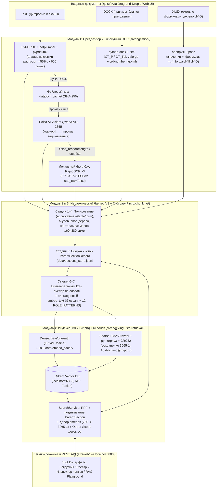
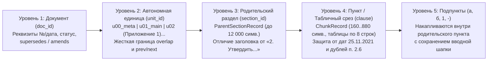

# Навигатор сотрудника по внутренним регламентам МФТИ (RAG V3: Parent-Child + 12% Bilateral Overlap)

Отказоустойчивая векторно-гибридная база знаний по нормативным документам МФТИ (приказы, регламенты, распоряжения, сметы и финансовая структура в форматах `.pdf`, `.docx`, `.xlsx`) со **структурно-иерархическим чанкером схемы V3 (7 стадий, 5 уровней иерархии, Parent-Child + двустороннее перекрытие 12% по границам слов)**, двухуровневым гибридным OCR-контуром, графом версионности и частичных изменений приказов (`supersedes` / `amends`) и локальным веб-приложением управления базой на `http://localhost:8000`.

---

## Содержание

1. [Ключевые возможности и решаемые проблемы корпуса МФТИ](#1-ключевые-возможности-и-решаемые-проблемы-корпуса-мфти)
2. [Архитектура системы и поток данных](#2-архитектура-системы-и-поток-данных)
3. [Схема иерархического чанкинга V3 (7 стадий)](#3-схема-иерархического-чанкинга-v3-7-стадий)
4. [Требования к окружению, зависимости и внешние сервисы](#4-требования-к-окружению-зависимости-и-внешние-сервисы)
5. [Настройки и переменные окружения (`.env`)](#5-настройки-и-переменные-окружения-env)
6. [Быстрый запуск и остановка (Docker Compose и локально)](#6-быстрый-запуск-и-остановка-docker-compose-и-локально)
7. [Руководство по веб-приложению (`http://localhost:8000`)](#7-руководство-по-веб-приложению-httplocalhost8000)
8. [Справочник REST API](#8-справочник-rest-api)
9. [Типовые пользовательские сценарии (Use Cases)](#9-типовые-пользовательские-сценарии-use-cases)
10. [Результаты комплексной валидации (`verify_retrieval.py` и `pytest`)](#10-результаты-комплексной-валидации-verify_retrievalpy-и-pytest)
11. [Ограничения решения и план дальнейшего развития (Roadmap)](#11-ограничения-решения-и-план-дальнейшего-развития-roadmap)

---

## 1. Ключевые возможности и решаемые проблемы корпуса МФТИ

Система спроектирована без использования примитивных символьных сплиттеров (`RecursiveCharacterTextSplitter`, `TokenTextSplitter`), которые разрушают структуру нормативных актов. Вместо них реализован специализированный доменный конвейер:

- **Двухуровневый гибридный OCR с защитой от ловушек сканов:**
  - Автоматическое определение комбинированных сканов, где поверх растрового изображения наложен короткий текстовый штамп согласования/ЭДО (`Регламент поселения сотрудников.pdf` стр. 1 — 148 символов штампа; `Регламент бронирования конц зала.pdf` стр. 6 — 13 символов).
  - Рендеринг при `300 DPI` с автоповоротом альбомных страниц и ограничением длинной стороны `MAX_OCR_IMAGE_SIDE = 3509 px` для гигантских сканов (`5167×7305 px`).
  - Основной контур: Vision LLM `qwen/qwen3-vl-235b-a22b-instruct` (через Polza AI) с жесткой защитой от зацикливания на пустых бланках подписей (`[___]` вместо бесконечных `_____` на стр. 7 `Регламент бронирования конц зала.pdf`).
  - Автоматический локальный CPU-фоллбэк: `RapidOCR v3 (PP-OCRv5, ESLAV, MOBILE)` с `Global.use_cls = False` (предотвращает переворот широких русских строк на 180°) и `Det.box_thresh = 0.3`.
- **Двухпроходный парсинг таблиц и формул Excel (`.xlsx`) и списков Word (`.docx`):**
  - Одновременное чтение вычисленных значений (`data_only=True`) и зашитых формул (`data_only=False`) в формате `[формула: =SUM(...)]`. Решает проблему пустых `cached_value=None` в книге `Приложение 1_новая смета 2019 (с незащищенными формулами).xlsx` (848 формул, коды КВР/КОСГУ, НДС 20%, накладные 20%) без записи `"None"`.
  - Протяжка (`forward-fill`) объединенных ячеек и 5-уровневой иерархии подразделений (`Финансодержатель -> ЦФО 1 -> ЦФО 2 -> ЦФО 3 -> ЦФО 4` в `Приложение к приказу об утверждении фин. структуры 2026г..xlsx`).
  - Полная поддержка как явной нумерации пунктов, так и XML-автонумерации Word (`w:numPr` + `word/numbering.xml`), а также склейка оторванных номеров пунктов в PDF (`Регламент поиска и подбора персонала.pdf`).
- **Граф редакций, отмен и частичных изменений (`supersedes` / `amends`):**
  - Различение полной отмены документа (`Приказ № 794-1` отменяет `1469-1`, но оставляет смету 2019 г. в статусе `superseded_template_reference` как единственный источник кодов КВР/КОСГУ и формул; `Приказ № 5990-1` отменяет `1465-1`) и частичного изменения (`Распоряжение № 700` изменяет `Приказ № 3065-1` по ФЛС без отмены базового приказа).
  - При поиске по частично измененному приказу (`3065-1`) система автоматически добирает изменяющие чанки из `Распоряжения № 700` в `amendment_chunks` и формирует `version_alerts`.
- **Кросс-файловая дедупликация (`content_hash` + `also_in_files`):**
  - Нормализованный SHA-256 хэш текста предотвращает засорение топ-выдачи идентичными приложениями из разных файлов (`Приказ N 3699-1` и `Приложения к приказу_ о формировании бюджетирования 2026г..docx`; `Приказ N 3614-1` и `.xlsx` финструктуры), объединяя источники в поле `also_in_files`.

---

## 2. Архитектура системы и поток данных



### Структура репозитория

```text
.
├── config/
│   ├── glossary.yaml               # Двусторонний словарь аббревиатур МФТИ, синонимы и 12 ROLE_PATTERNS
│   └── registry_overrides.yaml     # Граф редакций приказов (supersedes, amends), годы и предупреждения
├── data/
│   ├── uploads/                    # Файлы, загруженные через веб-интерфейс
│   ├── ocr_cache/                  # Кэш распознанных OCR-страниц по SHA-256 изображения
│   ├── embed_cache/                # Кэш векторов baai/bge-m3 по SHA-256(embed_text)
│   ├── qdrant_storage/             # Персистентное хранилище Qdrant
│   ├── sections_store.json         # Чистые родительские разделы ParentSectionRecord
│   ├── document_registry.json      # Реестр документов, SHA-256, метаданные и граф связей
│   └── indexing_report.json        # Детальный отчет последнего прогона индексации
├── src/
│   ├── config.py                   # Константы, пороги, настройки .env и регулярные выражения
│   ├── schemas.py                  # Модели Pydantic v2 (ParsedBlock, ChunkRecord, SearchResponse и др.)
│   ├── ingestion/
│   │   ├── ocr_engine.py           # Гибридный OCR: Qwen3-VL (Polza AI) + RapidOCR v3 PP-OCRv5 ESLAV
│   │   └── parsers.py              # Парсеры PDF, DOCX, XLSX в поток типизированных ParsedBlock
│   ├── chunking/
│   │   ├── glossary.py             # GlossaryManager + автообучение терминам + ролевые паттерны
│   │   └── hierarchical_chunker.py # 7-стадийный конечный автомат чанкинга схемы V3
│   ├── indexing/
│   │   ├── embedder.py             # Dense (baai/bge-m3) + локальный русский Sparse BM25 (CRC32 + IDF)
│   │   ├── qdrant_store.py         # Работа с Qdrant, гибридный запрос Prefetch + RRF Fusion
│   │   └── pipeline.py             # Оркестратор индексации, дедупликации и графа редакций
│   ├── retrieval/
│   │   └── search_service.py       # Поисковый сервис, гидратация ParentSection, добор amends, Out-of-Scope
│   └── web/
│       ├── app.py                  # FastAPI сервер на http://localhost:8000
│       └── static/index.html       # Русскоязычный веб-интерфейс загрузчика, инспектора и поиска
├── tests/
│   └── test_chunker_v3.py          # Модульные тесты всех краевых случаев чанкера V3
├── verify_retrieval.py             # Скрипт комплексной E2E-проверки (10 контрольных сценариев)
├── Dockerfile                      # Образ python:3.12-slim с предзагрузкой RapidOCR и pymorphy3
├── docker-compose.yml              # Оркестрация Qdrant (6333) + rag-app (8000)
├── requirements.txt                # Зафиксированные зависимости Python 3.12
└── README.md                       # Документация проекта
```

---

## 3. Схема иерархического чанкинга V3 (7 стадий)

Чанкер `HierarchicalChunkerV3` (`src/chunking/hierarchical_chunker.py`) разбирает поток `ParsedBlock` в **5-уровневое иерархическое дерево** и формирует дочерние чанки (`ChunkRecord`) и родительские разделы (`ParentSectionRecord`):



### Последовательность 7 стадий обработки

1. **Стадия 1 (Зонирование и очистка шума):**
   - По триггеру `ЛИСТ СОГЛАСОВАНИЯ` переводит блоки в неответную зону `zone="approval"`, а при встрече `Приложение №...`, `УТВЕРЖДЕН...`, `РЕГЛАМЕНТ`, `ПОРЯДОК` автоматически возвращает `zone="normative"`.
   - Склеивает дефисные переносы строк PDF, удаляет колонтитулы (`Стр. 3 из 14`), очищает прилипшие сноски в номерах актов (`№ 8123 -> № 812`) и разворачивает однострочные таблицы-рамки реквизитов Word (`от 28.03.2023 | № 794-1`) для извлечения номера и даты.
2. **Стадия 2 (Построение 5-уровневой иерархии):**
   - Смена `unit_id` (`u01_main`, `u02`...) при переходе к приложениям/утвержденным регламентам со сбросом нумерации разделов.
   - Умное различение заголовков разделов (`SECTION_TITLE_STARTERS`: *порядок, общие положения, правила, требования*...) и распорядительных пунктов приказа (`IMPERATIVE_VERB_STOPWORDS`: *утвердить, возложить, отменить, приказываю*...).
   - Защита от ложного срабатывания на даты (`DATE_PREFIX_RE`: `25.11.2021`, `01.09.2025` никогда не бьются как п. `25.11` или `1.9`) и защита от дублирующихся номеров пунктов в исходнике (`п. 2.6` и `2.7` в Приказе № 3065-1, `п. 3.2` в Распоряжении № 700 получают уникальные синтетические `chunk_id` и детерминированные `UUIDv5`).
3. **Стадия 3 (Специальная нарезка таблиц, форм и `u00_meta`):**
   - `zone="table"`: нарезка пачками по `TABLE_SLICE_ROWS = 8` строк с принудительным повтором шапки таблицы (`table_headers`) и протянутой иерархии (`Финансодержатель -> ЦФО 1..4`).
   - `zone="form"`: компактная упаковка бланков смет и заявок по `380–560` символов с сохранением кодов КВР/КОСГУ и формул `[формула: =...]`.
   - `zone="meta"`: генерация карточки паспорта версионности `u00_meta` (не занимает слоты нормативной выдачи, но поднимает `version_alerts` и `quality_alerts`).
4. **Стадия 4 (Двусторонний контроль размера `MIN_CLAUSE_CHARS = 160` .. `MAX_CLAUSE_CHARS = 880`):**
   - Разрезание длинных пунктов по границам предложений/подпунктов с подстановкой шапки `(Продолжение п. X: <первые 120 симв.>...)` и нумерацией частей `п. X (ч. 1)`, `п. X (ч. 2)`.
   - 3-проходное слияние коротких чанков (`< 160` символов): проход вперед внутри раздела (`"1.2, 1.3"`), проход назад для хвостового остатка и приклейка одиночных коротких блоков внутри `unit_id`.
5. **Стадия 5 (Сборка чистых родительских разделов `ParentSectionRecord`):**
   - Выполняется **строго после Стадии 4 и до Стадии 6**, формируя чистый текст раздела без дублирующихся хвостов перекрытия (до `12 000` символов) и сохраняя его в `data/sections_store.json`.
6. **Стадия 6 (Билатеральное перекрытие 12% строго по границам слов):**
   - Для каждого чанка `i` внутри одного `unit_id` вычисляется `12%` overlap: для текста в окне **`35–95` символов**, для таблиц/форм в окне **`24–48` символов**.
   - Сверху добавляется `...<хвост чанка i-1>`, снизу — `<начало чанка i+1>...` строго по границам пробелов/слов без разрезания слов или чисел. Между разными `unit_id` (`u01_main` и `u02`) перекрытия и ссылки `prev_id`/`next_id` жестко изолированы.
7. **Стадия 7 (Формирование `raw_text` и обогащенного `embed_text`):**
   - Формирует контекстный `embed_text` с реквизитами документа, статусом, годами действия, названием раздела, ролями и расшифровками аббревиатур из `GlossaryManager`:
     ```text
     [Документ: <Название> (№ <номер> от <дата>) | Редакция/Статус: <status_ru> | Годы: <applicable_years> | Часть: <unit_title> | Раздел <N>: <section_title> | Пункт: <clause_no> | Роли: <roles> | Темы: <topics>]
     [Термины: <АББР (расшифровка)>; ...]
     <raw_text>
     ```

---

## 4. Требования к окружению, зависимости и внешние сервисы

### Требования к окружению
- **ОС:** Linux / macOS / Windows (WSL2)
- **Python:** `3.12+` (рекомендуется `CPython 3.12`)
- **Docker и Docker Compose:** `Docker Engine 24.0+` и `docker compose v2` (для контейнерного запуска Qdrant и веб-сервиса)
- **ОЗУ и диск:** от 2 ГБ свободной ОЗУ и 3 ГБ места на диске

### Внешние сервисы и компоненты
1. **Polza AI API (`https://polza.ai/api/v1`)** — OpenAI-совместимый шлюз:
   - Модель плотных эмбеддингов: `baai/bge-m3` (размерность `1024`, Cosine).
   - Vision-модель для гибридного OCR сканов: `qwen/qwen3-vl-235b-a22b-instruct` (при недоступности или срабатывании защиты от зацикливания система автоматически переключается на встроенный офлайн-движок `RapidOCR v3`).
2. **Qdrant (`qdrant/qdrant:latest`, порт `6333`)** — векторная СУБД с поддержкой гибридного поиска по Dense (`1024d`) и Sparse (`BM25 + IDF`) векторам со слиянием `Reciprocal Rank Fusion (RRF)`.

### Основные зависимости (`requirements.txt`)
- Веб-сервер и API: `fastapi`, `uvicorn[standard]`, `python-multipart`, `httpx`
- Типизация и конфигурация: `pydantic>=2.0`, `pydantic-settings`, `python-dotenv`, `pyyaml`
- Парсинг и гибридный OCR: `PyMuPDF`, `pypdfium2`, `pdfplumber`, `Pillow`, `rapidocr`, `onnxruntime`, `python-docx`, `lxml`, `openpyxl`
- Русский NLP и поиск: `razdel`, `pymorphy3`, `qdrant-client`, `openai`, `tenacity`
- Тестирование: `pytest`, `pytest-asyncio`

---

## 5. Настройки и переменные окружения (`.env`)

Все настройки загружаются из файла `.env` в корне проекта (шаблон приведен в `.env.example`):

| Переменная | Значение по умолчанию | Описание |
| :--- | :--- | :--- |
| `POLZA_API_KEY` | *(обязательно)* | API-ключ Polza AI для генерации эмбеддингов `baai/bge-m3` и VLM OCR |
| `POLZA_BASE_URL` | `https://polza.ai/api/v1` | Базовый URL OpenAI-совместимого API Polza AI |
| `POLZA_EMBEDDING_MODEL` | `baai/bge-m3` | Модель плотных векторов (`1024d`) |
| `POLZA_VLM_MODEL` | `qwen/qwen3-vl-235b-a22b-instruct` | Мультимодальная модель для распознавания сканов в режиме `hybrid_vlm` |
| `OCR_BACKEND` | `hybrid_vlm` | Режим OCR: `hybrid_vlm` (Qwen3-VL + фоллбэк RapidOCR) или `local_rapidocr` (полностью офлайн) |
| `QDRANT_URL` | `http://localhost:6333` | URL подключения к серверу Qdrant (`http://qdrant:6333` внутри Docker Compose) |
| `QDRANT_HOST` | `localhost` | Хост Qdrant |
| `QDRANT_PORT` | `6333` | HTTP-порт Qdrant |
| `QDRANT_COLLECTION` | `mipt_normative_v3` | Название коллекции в Qdrant |
| `EMBEDDING_DIM` | `1024` | Размерность dense-векторов |
| `EMBEDDING_BATCH_SIZE` | `32` | Размер батча при отправке текстов в API эмбеддингов |
| `DOCS_DIR` | `доки` | Путь к директории с нормативными документами МФТИ |
| `DATA_DIR` | `data` | Путь к директории кэшей, реестра и хранилища разделов |
| `CONFIG_DIR` | `config` | Путь к директории с `glossary.yaml` и `registry_overrides.yaml` |
| `APP_HOST` | `0.0.0.0` | Хост веб-приложения FastAPI |
| `APP_PORT` | `8000` | Порт веб-приложения FastAPI (`http://localhost:8000`) |
| `LOG_LEVEL` | `INFO` | Уровень логирования (`DEBUG`, `INFO`, `WARNING`, `ERROR`) |

---

## 6. Быстрый запуск и остановка (Docker Compose и локально)

### Вариант А. Запуск одной командой через Docker Compose (рекомендуется)

```bash
# 1. Убедитесь, что в корне проекта есть файл .env с вашим POLZA_API_KEY
#    (при чистом развертывании: cp .env.example .env и укажите POLZA_API_KEY)

# 2. Сборка и запуск Qdrant (6333) + веб-сервиса rag-app (8000) в фоновом режиме:
docker compose up -d --build

# 3. Проверка статуса сервисов:
curl http://localhost:8000/api/health

# 4. Остановка сервисов (с сохранением проиндексированных данных в ./data):
docker compose down
```

### Вариант Б. Локальный запуск в виртуальном окружении Python 3.12

```bash
# 1. Поднимите контейнер Qdrant на порту 6333:
docker compose up -d qdrant

# 2. Создайте виртуальное окружение Python 3.12 и установите зависимости:
uv venv --python 3.12 .venv
source .venv/bin/activate
uv pip install -r requirements.txt

# 3. Запустите веб-сервер и индексатор на http://localhost:8000:
.venv/bin/uvicorn src.web.app:app --host 0.0.0.0 --port 8000

# 4. Запуск автотестов чанкера V3 и комплексной валидации поиска (10 сценариев):
.venv/bin/pytest tests/test_chunker_v3.py -v
.venv/bin/python verify_retrieval.py
```

---

## 7. Руководство по веб-приложению (`http://localhost:8000`)

Откройте в браузере **`http://localhost:8000`**. Интерфейс разделен на 3 рабочие вкладки:

1. **«Загрузка и синхронизация»:**
   - **Кнопка «Синхронизировать папку `доки/`»** — сканирует папку `доки/`, вычисляет `SHA-256` каждого файла и инкрементально индексирует новые или изменившиеся документы без изменения исходного кода.
   - **Drag-and-Drop мультизагрузка файлов (`.pdf`, `.docx`, `.xlsx`)** — позволяет загрузить новые приказы или регламенты прямо из браузера с указанием метаданных: статуса (`active`, `superseded`, `superseded_template_reference`, `draft`), номеров отменяемых (`supersedes`) и изменяемых (`amends`) приказов, годов действия (`applicable_years`), комментария к редакции (`version_note`) и режима OCR (`hybrid_vlm` / `local_rapidocr`).
   - **Живой прогресс-бар по 6 стадиям** (*Предразбор → OCR сканов → Иерархический чанкинг V3 → Наложение 12% overlap → Векторизация `baai/bge-m3` + BM25 → Запись в Qdrant*) со счетчиком созданных разделов и чанков.
2. **«Реестр документов и инспектор чанков»:**
   - Таблица всех 16+ документов с реквизитами (номер, дата, формат, страницы/OCR-страницы, число `Parent`-разделов и `Child`-чанков), статусными плашками и бейджами графа редакций (`Изменяет № 3065-1`, `Отменен № 794-1`, `Дублируется в ...`).
   - **Модальное окно инспектора чанков:** визуальный просмотр дерева `unit_id -> ParentSectionRecord -> ChunkRecord`, переключение между `raw_text` (с визуальной подсветкой верхнего и нижнего `...12% overlap...`) и полным `embed_text`, редактирование связей документа (`PATCH`) и удаление из базы (`DELETE`).
3. **«Тест гибридного поиска (RAG Playground)»:**
   - Поисковая строка с настройкой `top_k`, фильтрами по статусу и году действия, индикатором `Уверенный ответ / Out-of-Scope`, плашками предупреждений о смене редакции (`version_alerts`), блоком автоматически подтянутых поправок (`amendment_chunks`) и раскрывающимся полным текстом родительского раздела (`ParentSectionRecord`).

---

## 8. Справочник REST API

Автоматическая интерактивная документация Swagger UI доступна по адресу **`http://localhost:8000/docs`**.

| Метод и путь | Описание |
| :--- | :--- |
| `GET /api/health` | Статус подключения к Qdrant, конфигурации Polza AI API, число точек в коллекции и документов в реестре |
| `POST /api/documents/sync-folder` | Инкрементальная синхронизация папки `доки/` по `SHA-256` (параметры `force`, `ocr_backend`) |
| `POST /api/documents/upload` | Мультизагрузка новых файлов (`multipart/form-data`) с метаданными версионности и запуском индексации |
| `GET /api/documents` | Список всех документов реестра, граф связей редакций и отчет `indexing_report.json` |
| `GET /api/documents/{doc_id}/chunks` | Полное дерево родительских разделов (`sections`) и дочерних чанков (`chunks`) документа |
| `PATCH /api/documents/{doc_id}/metadata` | Обновление связей (`supersedes`, `amends`, `status`, `version_note`, `applicable_years`) в реестре и Qdrant |
| `DELETE /api/documents/{doc_id}` | Полное удаление документа из Qdrant, `sections_store.json` и `document_registry.json` |
| `POST /api/search` | Гибридный поиск (Dense `baai/bge-m3` + Sparse `BM25` + `RRF`) с возвратом `hits`, `amendment_chunks`, `version_alerts` и `is_out_of_scope` |

---

## 9. Типовые пользовательские сценарии (Use Cases)

### Use Case 1: Разговорный вопрос по сканированному регламенту (бронирование Концертного зала)

- **Входной запрос (`POST /api/search`):**
  ```json
  {
    "query": "Хотим провести студенческий концерт в концертном зале института: за сколько месяцев надо закинуть служебку и на какую электронную почту ее отправлять?",
    "top_k": 5,
    "include_parent": true
  }
  ```
- **Поток обработки:**
  1. `GlossaryManager` расширяет разговорный запрос доменными синонимами (`КЗ`, `служебная записка`, `культурно-массовый отдел`, `kmo@mipt.ru`).
  2. Гибридный поиск RRF находит релевантные чанки п. `2.3` и п. `2.6` из распознанного скана `Регламент бронирования конц зала.pdf` и подтягивает полный чистый текст Раздела 2 из `sections_store.json`.
- **Ожидаемый результат:**
  - `is_out_of_scope`: `false`
  - Источник: `Регламент бронирования конц зала.pdf` (Раздел 2 «Порядок бронирования Концертного зала», п. `2.3` и `2.6`).
  - Извлеченные факты: служебная записка подается **не позднее чем за 2 месяца** до даты проведения мероприятия и направляется на электронную почту культурно-массового отдела **`kmo@mipt.ru`**.

### Use Case 2: Поиск по частично измененному приказу (открытие и присвоение номера ФЛС)

- **Входной запрос (`POST /api/search`):**
  ```json
  {
    "query": "Порядок открытия финансово-лицевого счета (ФЛС) по приказу 3065-1 и актуальная структура присвоения уникального номера ФЛС (разряды кода, КФО)",
    "top_k": 5,
    "include_parent": true,
    "include_amendments": true
  }
  ```
- **Поток обработки:**
  1. Поисковый сервис находит базовый `Приказ N 3065-1 от 25.11.2021.docx` (Регламент открытия ФЛС, Раздел 2) и видит в графе редакций активную связь `amended_by: ["700"]`.
  2. Система автоматически добирает изменяющие чанки из `Распоряжение N 700 от 28.12.2024 Порядок присвоения номера ФЛС.docx` (п. `2.1–2.3` о 11–18-разрядной структуре номера ФЛС и кодах КФО `01..07, 32`) и прикрепляет предупреждение в `version_alerts`.
- **Ожидаемый результат:**
  - `is_out_of_scope`: `false`
  - В `hits` и `amendment_chunks` одновременно возвращаются нормы базового Приказа № `3065-1` (согласование Карточки проекта в 1С:ДО за 1 рабочий день) и актуальные правила присвоения номера ФЛС по Распоряжению № `700` (разряды 1–5 — код подразделения, 6–7 — код финансодержателя, 8–9 — КФО, 10–18 — шифр проекта).
  - В `version_alerts` выводится явное уведомление о частичном изменении Приказа № `3065-1` Распоряжением № `700`.

### Use Case 3: Запрос со сменой редакции и извлечением формул Excel (сметы доходов и расходов)

- **Входной запрос (`POST /api/search`):**
  ```json
  {
    "query": "Как сейчас подается и согласовывается смета доходов и расходов в 1С:ДО (Приложение 1а по приказу 794-1) и какие коды КВР/КОСГУ и формулы расчета накладных расходов 20% и НДС 20% используются в шаблоне сметы?",
    "top_k": 6
  }
  ```
- **Ожидаемый результат:**
  - Возвращаются действующий `Приказ N 794-1 от 28.03.2023.docx` + `Приложение 1а Бланк сметы.docx` (смета формируется **помесячно** в системе **1С:ДО**, кроме годовых бумажных смет РЦНИ по форме 1б) И справочный шаблон `Приложение 1_новая смета 2019 (с незащищенными формулами).xlsx` (`status="superseded_template_reference"`) с извлеченными кодами КВР/КОСГУ и формулами `[формула: =IFERROR((F$13+F$22)*$B$23*-1,)]` (накладные 20%, НДС 20%), сопровождаемые плашкой `version_alerts`.

---

## 10. Результаты комплексной валидации (`verify_retrieval.py` и `pytest`)

### 10.1. Статистика индексации корпуса (`доки/` — 16 документов)

- **Проиндексировано файлов:** `16 / 16` (`failed_files = 0`)
- **Создано родительских разделов (`ParentSectionRecord` в `data/sections_store.json`):** `125`
- **Создано дочерних чанков (`ChunkRecord` в коллекции Qdrant `mipt_normative_v3`):** `1 263`
- **Сканированные PDF, прошедшие гибридный OCR (`22` страницы в `data/ocr_cache/`):** `3 / 3` (`Регламент бронирования конц зала.pdf` — 14 стр. / 75 чанков, `Регламент поселения сотрудников.pdf` — 3 стр. / 22 чанка, `Регламент эксплуатации центра обработки данных МФТИ, Физтех.pdf` — 5 стр. / 18 чанков)
- **Формулы Excel (`Приложение 1_новая смета 2019 (с незащищенными формулами).xlsx`):** извлечено `440` расчетных формул `[формула: =...]` в `91` чанке без единого вхождения `"None"`
- **Кросс-файловая дедупликация (`content_hash` + `also_in_files`):** `246` совпавших табличных чанков между `Приказ N 3614-1.docx` и `Приложение к приказу об утверждении фин. структуры 2026г..xlsx`; `77` совпавших чанков между `Приказ N 3699-1.docx` и `Приложения к приказу_ о формировании бюджетирования 2026г..docx`
- **Автотесты краевых случаев чанкера V3 (`pytest tests/test_chunker_v3.py`):** `61 / 61 PASSED` (1.25 с)
- **Зазор между релевантными (Scenarios 1–8) и нерелевантными (Scenarios 9–10) запросами:** `Δdense = +0.1578` (`min_in_scope = 0.6163` vs `max_out_of_scope = 0.4585`), `Δconfidence = +0.4785` (`min_in_scope = 0.6390` vs `max_out_of_scope = 0.1605`)

### 10.2. Сводная таблица 10 контрольных сценариев (`verify_retrieval.py`)

| № | Код сценария | Проверяемая особенность базы МФТИ | Статус | `is_out_of_scope` | Top Dense Score | Confidence Score | Top RRF Score | Ключевые найденные источники и реквизиты |
| :-: | :--- | :--- | :-: | :-: | :-: | :-: | :-: | :--- |
| 1 | `S01_COLLOQUIAL_KZ` | Разговорный вопрос без казенных слов (бронирование КЗ: за сколько месяцев и на какую почту) | ✅ PASS | `False` | `0.6163` | `0.6390` | `0.6000` | `Регламент бронирования конц зала.pdf` (п. 2.3, 2.6: `2 месяца`, `kmo@mipt.ru`) |
| 2 | `S02_SCANNED_TABLE_KZ` | Табличный запрос из скана (репетиционные дни в КЗ на Посвящение в студенты) | ✅ PASS | `False` | `0.6608` | `0.7384` | `0.7500` | `Регламент бронирования конц зала.pdf` (стр. 4, табл. п. 6.1, стр. 13: `6` дней) |
| 3 | `S03_GIANT_SCAN_DORM` | Гигантский скан со штампом согласования (порядок поселения сотрудников в общежитие) | ✅ PASS | `False` | `0.7696` | `0.8133` | `0.6667` | `Регламент поселения сотрудников.pdf` (п. 1.2, 1.3, 3.1, 3.9: условия и комиссия) |
| 4 | `S04_SMETA_SUPERSESSION` | Смена редакции смет (`794-1` и Прил. 1а в 1С:ДО vs формулы КВР/КОСГУ в смете 2019 г.) | ✅ PASS | `False` | `0.8105` | `0.8583` | `1.0000` | `Приложение 1а Бланк сметы.docx`, `Приложение 1_новая смета 2019.xlsx` + `3 version_alerts` |
| 5 | `S05_FLS_AMENDMENT_GRAPH` | Частичное изменение приказа (`Приказ № 3065-1` + `Распоряжение № 700` по номеру ФЛС) | ✅ PASS | `False` | `0.7982` | `0.8890` | `0.5455` | `Приказ N 3065-1` + `Распоряжение N 700` (`5 amendment_chunks` + `2 version_alerts`) |
| 6 | `S06_BUDGET_YEARS_2026_2028` | Расхождение нормативов по годам (`Приказ № 3699-1` на 2026–2028 гг.: резерв отпусков) | ✅ PASS | `False` | `0.7725` | `0.7549` | `1.0000` | `Приказ N 3699-1 от 18.08.2025.docx` (п. 18, 19, 20: `16,4%` ППС и `8,2%` прочие) |
| 7 | `S07_EXCEL_CFO_HIERARCHY` | Дерево ЦФО из широкой таблицы Excel (`Приказ № 3614-1`: `Финансодержатель -> ЦФО 1..4`) | ✅ PASS | `False` | `0.7784` | `0.8353` | `0.5270` | `Приказ N 3614-1.docx` + `Приложение к приказу об утверждении фин. структуры 2026г..xlsx` (`also_in_files`) |
| 8 | `S08_IT_SUPPORT_AND_DC` | Цифровой и сканированный ИТ-регламенты (Первая линия ТП `helpdesk@mipt.ru`, 16 ч и ЦОД) | ✅ PASS | `False` | `0.8122` | `0.8539` | `0.6250` | `Приказ и Регламент работы первой линии техподдержки.pdf` (п. 1.1, 2.1, 3.3–3.5) + `Регламент ЦОД` |
| 9 | `S09_OUT_OF_SCOPE_MORTGAGE` | Нерелевантный запрос #1 (Оформление семейной ипотеки в Сбербанке) | ✅ PASS | `True` | `0.4585` | `0.1605` | `0.5000` | Отсечен детектором (`is_out_of_scope = True`, `lexical_overlap = 0.000`) |
| 10 | `S10_OUT_OF_SCOPE_CARBONARA` | Нерелевантный запрос #2 (Рецепт пасты карбонара с гуанчиале) | ✅ PASS | `True` | `0.3129` | `0.1095` | `0.5000` | Отсечен детектором (`is_out_of_scope = True`, `lexical_overlap = 0.000`) |

---

## 11. Ограничения решения и план дальнейшего развития (Roadmap)

### Текущие ограничения
1. **Зависимость от внешнего API для построения плотных векторов (`baai/bge-m3`):** при полном отсутствии интернета поиск по уже проиндексированным чанкам может опираться на локальный индекс Qdrant, однако векторизация нового запроса требует подключения к Polza AI (либо локального контейнера `TEI / vLLM`).
2. **Сложные рукописные пометки на сканах:** гибридный контур `Qwen3-VL + RapidOCR v3` оптимизирован под машинописные сканы, таблицы и штампы ЭДО; неразборчивые рукописные резолюции поверх текста могут распознаваться с погрешностью.
3. **Автоматическое связывание графа версий по номеру акта:** если новый приказ отменяет старый документ без указания его номера (только по косвенному названию), требуется подтверждение связи оператором через веб-интерфейс на `localhost:8000`.

### План дальнейшего развития и внедрения в МФТИ
1. **Этап 1 (Интеграция с `1С:Документооборот` и корпоративным порталом МФТИ):**
   - Подключение вебхука автоматической синхронизации новых приказов и распоряжений напрямую из `1С:ДО` в `/api/documents/upload` сразу после регистрации штампа ЭДО.
2. **Этап 2 (Генеративный контур ответа с пошаговым планом действий и строгим цитированием):**
   - Добавление опционального LLM-синтезатора ответа поверх найденных `Child`-чанков, `ParentSectionRecord` и `amendment_chunks` с генерацией чек-листа шагов сотрудника и кликабельными ссылками на конкретные страницы PDF/DOCX.
3. **Этап 3 (Ролевой доступ и Telegram/Web-бот сотрудника):**
   - Учет роли сотрудника (ППС, руководитель научного проекта РНФ, администратор подразделения) для персонализации маршрутов согласования (например, ветки п. `2.3.1–2.3.5` Приказа № 794-1).
