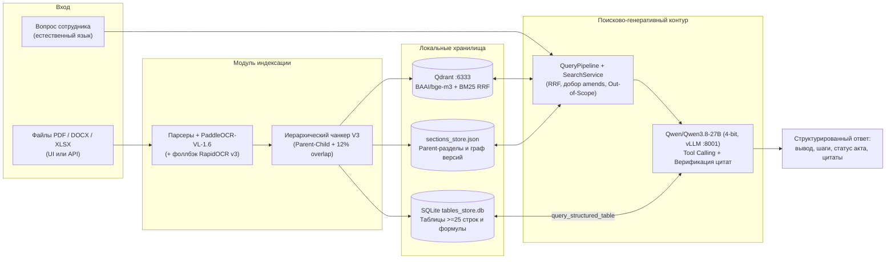

# ИИ-навигатор сотрудника по внутренним регламентам и приказам

Локальная on-premise RAG-система для навигации по внутренним нормативным документам организации (`.pdf`, включая сканы и комбинированные штампы ЭДО, `.docx`, `.doc`, `.xlsx` с формулами, `.xls`). Решение работает **полностью в закрытом контуре без передачи данных во внешние облачные API** и разворачивается в чистом окружении через Docker Compose без ручного изменения кода.

---

## 1. Ключевые возможности (соответствие ТЗ)

- **100% локальный стек моделей (конфиденциальные данные не покидают контур):**
  - **OCR документов и таблиц:** `PaddlePaddle/PaddleOCR-VL-1.6` (GPU VLM) + автоматический CPU-фоллбэк `RapidOCR v3 (PP-OCRv5 ESLAV)`.
  - **Плотные эмбеддинги:** `BAAI/bge-m3` (`1024d`, Cosine) в связке с русским морфологическим `Sparse BM25` (`razdel` + `pymorphy3`) и слиянием `Reciprocal Rank Fusion (RRF)` в **Qdrant**.
  - **Генерация и Tool Calling:** линейно-гибридная **`Qwen/Qwen3.8-27B` в 4-битной квантизации** (`RedHatAI/Qwen3.8-27B-INT4` через `vLLM` с `64K` контекстом или `BitsAndBytes NF4`).
- **Работа с «грязными» корпоративными данными без изменения кода:** загрузка новых документов через Drag-and-Drop в веб-интерфейсе или REST API, двухпроходное чтение значений и формул Excel (`[формула: =...]`), протяжка объединенных ячеек и иерархии ЦФО, распознавание автонумерации списков Word.
- **Структурно-иерархический чанкинг V3 и 3-уровневая маршрутизация таблиц:**
  - `Parent-Child` разбиение по разделам и пунктам с двусторонним `12%` перекрытием по границам слов (`ParentSectionRecord` в `sections_store.json`).
  - Компактные таблицы (`< 25` строк) передаются в контекст целиком за 1 проход (`inline_parent`), а книги `.xlsx` и крупные таблицы (`>= 25` строк) индексируются в **SQLite (`tables_store.db`)** для точной фильтрации, подсчета (`COUNT`/`SUM`/`GROUP BY`) и чтения формул через автономный `Tool Calling`.
- **Граф версий и защита от галлюцинаций:** автоматический учет отмен (`supersedes`) и частичных изменений (`amends`), посимвольная верификация дословных цитат с кликабельным предпросмотром страниц и `Out-of-Scope` фильтр нерелевантных вопросов.

---

## 2. Архитектура, структура проекта и сквозной поток данных



### Сквозной поток данных (от входа до выхода)
1. **Индексация документа:** файл поступает через веб-интерфейс или `POST /api/documents/upload` → вычисляется `SHA-256` → сканированные страницы PDF распознаются `PaddleOCR-VL-1.6`, из `.xlsx` извлекаются значения и формулы → `HierarchicalChunkerV3` формирует чистые родительские разделы, дочерние чанки с `12%` overlap и реляционные таблицы в SQLite → `BAAI/bge-m3` + `BM25` записывают векторы в `Qdrant`, а реестр обновляет связи `supersedes` / `amends`.
2. **Обработка вопроса:** запрос поступает в `POST /api/ask` → `QueryPipeline` раскрывает аббревиатуры по глоссарию и отсекает оффтоп → `SearchService` выполняет гибридный RRF-поиск в `Qdrant`, подтягивает `ParentSectionRecord`, изменяющие чанки (`amendment_chunks`) и предупреждения о статусе редакции (`version_alerts`) → `TableAwareRAGAgent` (`Qwen/Qwen3.8-27B` 4-bit) при наличии больших таблиц вызывает `query_structured_table` к SQLite, формирует ответ (краткий вывод, условный пошаговый порядок действий, подробный разбор) и верифицирует точные цитаты.

### Структура директорий репозитория

```text
.
├── config/
│   ├── glossary.yaml               # Доменный словарь аббревиатур, синонимов и ролей
│   └── registry_overrides.yaml     # Правила связей версий (опционально для локального демо-корпуса)
├── docs/
│   └── Описание кейса для участников.docx  # Исходное техническое задание
├── documents/                      # Демо-корпус документов по категориям (НЕ запекается в Docker-образ)
│   ├── regulations/                # Внутренние регламенты (.pdf)
│   ├── orders/                     # Приказы и распоряжения (.docx, .pdf)
│   └── appendices_and_forms/       # Приложения, сметы с формулами, финструктура и бланки (.xlsx, .docx)
├── scripts/
│   ├── setup_debian_server.sh      # Установка «под ключ» на чистый Debian/Ubuntu GPU-сервер
│   ├── docker-entrypoint.sh        # Entrypoint контейнера приложения (инициализация пустых томов)
│   ├── start_local_stack.sh        # Запуск Qdrant + vLLM + FastAPI без Docker
│   ├── verify_retrieval.py         # E2E-проверка гибридного поиска (10 сценариев)
│   └── verify_tables_e2e.py        # E2E-проверка SQLite-таблиц и LLM Tool Calling (5 сценариев)
├── src/
│   ├── ingestion/                  # Парсеры PDF/DOCX/XLSX и локальный OCR (PaddleOCR-VL-1.6 + RapidOCR)
│   ├── chunking/                   # 7-стадийный чанкер V3 и менеджер глоссария
│   ├── indexing/                   # Эмбеддинги BAAI/bge-m3, Qdrant RRF, SQLite таблицы, пайплайн
│   ├── llm/                        # Конфигурация 4-битной Qwen/Qwen3.8-27B (vLLM INT4 / BitsAndBytes NF4)
│   ├── retrieval/                  # Поиск, QueryPipeline, RAG-агент и верификатор цитат
│   ├── web/                        # FastAPI сервер (:8000) и русскоязычный SPA-интерфейс
│   ├── config.py                   # Централизованные настройки окружения (.env)
│   └── schemas.py                  # Схемы данных Pydantic v2
├── tests/                          # Модульные и интеграционные автотесты pytest (204 теста)
├── Dockerfile                      # Чистый образ приложения без предзашитой БД и документов
├── .dockerignore                   # Исключение data/, documents/, docs/ из контекста сборки
├── docker-compose.yml              # Полный стек: qdrant + vllm-qwen38 + rag-app с чистыми томами
├── .env.example                    # Шаблон переменных окружения
└── requirements.txt                # Python-зависимости
```

---

## 3. Требования к окружению, сервисы и зависимости

- **ОС:** Debian 12+ / Ubuntu 22.04+ (или WSL2 с поддержкой GPU).
- **Аппаратные ресурсы:** NVIDIA GPU от **24 ГБ VRAM** (рекомендуется `24–40+ ГБ`: `RTX 3090/4090`, `L40S`, `A100`), от **16 ГБ ОЗУ**, от **35 ГБ** на диске под Docker-образы и кэш весов HuggingFace.
- **Системное ПО:** `Docker Engine 24+`, `Docker Compose v2`, драйвер NVIDIA (`535+`) и `NVIDIA Container Toolkit` (при запуске без Docker — `Python 3.12+` и `LibreOffice` nogui).
- **Перечень инфраструктурных сервисов (`docker-compose.yml`):**
  1. `qdrant` (`qdrant/qdrant:latest`, порт `6333`) — векторная БД.
  2. `vllm-qwen38` (`vllm/vllm-openai:latest`, порт `8001`) — локальный OpenAI-совместимый сервер `RedHatAI/Qwen3.8-27B-INT4` (`Qwen/Qwen3.8-27B`).
  3. `rag-app` (`Dockerfile`, порт `8000`) — FastAPI, веб-интерфейс, `BAAI/bge-m3`, `PaddleOCR-VL-1.6`, `RapidOCR` и `SQLite`.
  - **Внешние облачные API:** не используются (`0` внешних вызовов при индексации и ответах; при первом старте контейнеры скачивают открытые веса моделей с HuggingFace Hub в том `hf_cache`).
- **Основные зависимости (`requirements.txt`):** `fastapi`, `uvicorn`, `pydantic>=2.0`, `qdrant-client`, `openai`, `torch`, `transformers>=4.51`, `accelerate`, `bitsandbytes`, `sentence-transformers`, `PyMuPDF`, `pdfplumber`, `pypdfium2`, `rapidocr`, `onnxruntime`, `python-docx`, `openpyxl`, `razdel`, `pymorphy3`, `pytest`.

---

## 4. Установка с нуля на чистый Debian-подобный сервер (`Debian 12` / `Ubuntu 22.04+`)

Ниже приведена полная инструкция развертывания на **только что установленный** сервер Debian/Ubuntu с видеокартой NVIDIA.

### Быстрый вариант (одним скриптом)

```bash
sudo apt-get update && sudo apt-get install -y git
git clone https://github.com/aren209/INBICST_hack80.git
cd INBICST_hack80
sudo ./scripts/setup_debian_server.sh
```
*(Если на чистом сервере еще не стоял драйвер NVIDIA, скрипт установит его и попросит выполнить `sudo reboot`, после чего повторный запуск `sudo ./scripts/setup_debian_server.sh` поднимет весь Docker-стек).*

### Пошаговая ручная установка на чистый Debian 12 / Ubuntu 22.04–24.04

```bash
# Шаг 1. Базовые пакеты
sudo apt-get update -y
sudo apt-get install -y ca-certificates curl gnupg lsb-release git pciutils

# Шаг 2. Драйвер NVIDIA (пропустите, если nvidia-smi уже выводит видеокарту)
# Для Debian 12:
sudo sed -i 's/main$/main contrib non-free non-free-firmware/' /etc/apt/sources.list
sudo apt-get update -y
sudo apt-get install -y "linux-headers-$(uname -r)" nvidia-driver firmware-misc-nonfree
# (Для Ubuntu вместо 3 строк выше: sudo apt-get install -y ubuntu-drivers-common && sudo ubuntu-drivers install --gpgpu)
sudo reboot
# После перезагрузки убедитесь, что GPU виден:
nvidia-smi

# Шаг 3. Установка официального Docker Engine и Docker Compose v2
sudo install -m 0755 -d /etc/apt/keyrings
. /etc/os-release
curl -fsSL "https://download.docker.com/linux/${ID}/gpg" | sudo gpg --dearmor -o /etc/apt/keyrings/docker.gpg
sudo chmod a+r /etc/apt/keyrings/docker.gpg
echo "deb [arch=$(dpkg --print-architecture) signed-by=/etc/apt/keyrings/docker.gpg] https://download.docker.com/linux/${ID} ${VERSION_CODENAME} stable" \
  | sudo tee /etc/apt/sources.list.d/docker.list > /dev/null
sudo apt-get update -y
sudo apt-get install -y docker-ce docker-ce-cli containerd.io docker-buildx-plugin docker-compose-plugin
sudo systemctl enable --now docker

# Шаг 4. Установка NVIDIA Container Toolkit (проброс GPU в контейнеры)
curl -fsSL https://nvidia.github.io/libnvidia-container/gpgkey \
  | sudo gpg --dearmor -o /usr/share/keyrings/nvidia-container-toolkit-keyring.gpg
curl -s -L https://nvidia.github.io/libnvidia-container/stable/deb/nvidia-container-toolkit.list \
  | sed 's#deb https://#deb [signed-by=/usr/share/keyrings/nvidia-container-toolkit-keyring.gpg] https://#g' \
  | sudo tee /etc/apt/sources.list.d/nvidia-container-toolkit.list > /dev/null
sudo apt-get update -y
sudo apt-get install -y nvidia-container-toolkit
sudo nvidia-ctk runtime configure --runtime=docker
sudo systemctl restart docker

# Шаг 5. Клонирование проекта и запуск чистого стека
git clone https://github.com/aren209/INBICST_hack80.git
cd INBICST_hack80
cp .env.example .env                # опционально (стек запускается и без .env)
sudo docker compose up -d --build
```

### Управление контейнерами и загрузка документов

> **Чистая сборка:** `.dockerignore` и `Dockerfile` не копируют существующие базы (`data/`) и регламенты (`documents/`) внутрь образа. Контейнер поднимается с чистыми именованными томами (`qdrant_storage`, `rag_data`, `hf_cache`).

```bash
# Проверка статуса и готовности API (первый старт скачивает веса моделей в том hf_cache):
sudo docker compose ps
curl http://localhost:8000/api/health

# Веб-приложение доступно на http://<IP_СЕРВЕРА>:8000 — загрузите файлы через Drag-and-Drop
# или отправьте любой документ через REST API:
curl -F 'files=@"documents/regulations/Регламент бронирования конц зала.pdf"' \
  http://localhost:8000/api/documents/upload

# Штатная остановка сервисов (с сохранением данных в Docker-томах):
sudo docker compose down

# Полная остановка с удалением томов БД (сброс в «чистое» состояние):
sudo docker compose down -v
```

### Альтернативный запуск без Docker (локальное окружение Python 3.12+)

```bash
pip install -r requirements.txt
./scripts/start_local_stack.sh
```

---

## 5. Настройки и переменные окружения (`.env`)

Все параметры задаются через переменные окружения или опциональный `.env` (см. `.env.example`):

| Переменная | По умолчанию | Назначение |
| :--- | :--- | :--- |
| `LLM_BACKEND` | `local_vllm` | Режим LLM: `local_vllm` (сервер vLLM INT4) или `local_bnb_4bit` (`BitsAndBytes NF4`) |
| `LOCAL_LLM_BASE_URL` | `http://localhost:8001/v1` | URL локального сервера `vLLM` (внутри Docker Compose автоматически `http://vllm-qwen38:8001/v1`) |
| `LOCAL_LLM_MODEL` | `Qwen/Qwen3.8-27B` | Имя обслуживаемой линейно-гибридной модели |
| `LOCAL_LLM_HF_QUANTIZED_REPO` | `RedHatAI/Qwen3.8-27B-INT4` | Репозиторий 4-битных весов `W4A16` |
| `VLLM_GPU_MEMORY_UTILIZATION` | `0.68` | Доля VRAM под `vLLM` (оставляет резерв под `bge-m3` и `PaddleOCR-VL-1.6`) |
| `VLLM_MAX_MODEL_LEN` | `65536` | Длина контекста `vLLM` для многошагового Tool Calling |
| `EMBEDDING_BACKEND` / `EMBEDDING_MODEL` | `local` / `BAAI/bge-m3` | Локальные плотные эмбеддинги (`1024d`) |
| `OCR_BACKEND` / `OCR_VL_MODEL` | `paddleocr_vl` / `PaddlePaddle/PaddleOCR-VL-1.6` | Локальный VLM OCR сканов и таблиц (+ фоллбэк `RapidOCR`) |
| `QDRANT_URL` / `QDRANT_COLLECTION` | `http://localhost:6333` / `mipt_normative_v3` | Адрес и коллекция Qdrant (в Docker Compose — `http://qdrant:6333`) |
| `DOCS_DIR` / `DATA_DIR` / `CONFIG_DIR` | `documents` / `data` / `config` | Директории документов (рекурсивный обход подпапок), индексов и словаря |
| `AUTO_SYNC_ON_STARTUP` | `false` | Автосинхронизация примонтированной `DOCS_DIR` при старте контейнера |
| `APP_HOST` / `APP_PORT` | `0.0.0.0` / `8000` | Хост и порт FastAPI |

---

## 6. Основные эндпоинты API и типовые сценарии (Use Cases)

Интерактивная документация OpenAPI доступна по адресу **`http://localhost:8000/docs`**.

| Эндпоинт | Описание |
| :--- | :--- |
| `GET /api/health` | Состояние Qdrant, локального стека моделей, число документов, чанков и SQLite-таблиц |
| `POST /api/documents/upload` | Мультизагрузка файлов (`.pdf`, `.docx`, `.doc`, `.xlsx`, `.xls`) с метаданными версий |
| `POST /api/documents/sync-folder` | Рекурсивная инкрементальная синхронизация директории `DOCS_DIR` по `SHA-256` |
| `GET /api/documents` / `DELETE /api/documents/{doc_id}` | Реестр документов, граф связей редакций и удаление документа из всех хранилищ |
| `POST /api/search` | Гибридный поиск (`BAAI/bge-m3` + `BM25 RRF`) с подтягиванием `ParentSection` и `amendment_chunks` |
| `POST /api/tables/query` | Детерминированная фильтрация, агрегация и чтение формул Excel в `tables_store.db` |
| `POST /api/ask` (`POST /api/ask/stream`) | Полный ответ ИИ-агента с пошаговым планом, учетом версий, Tool Calling и проверкой цитат |

### Use Case 1: Процедурный вопрос по скану регламента (`POST /api/ask`)
- **Вход:**
  ```json
  {
    "query": "Хотим провести студенческий концерт в концертном зале: за сколько месяцев подавать служебку и на какую почту отправлять?",
    "top_k": 5
  }
  ```
- **Ожидаемый выход:**
  - `is_out_of_scope`: `false`, источник: `Регламент бронирования конц зала.pdf` (действующий, Раздел 2, п. `2.3`, `2.6`).
  - Структурированный ответ содержит `### Краткий ответ` (**не позднее чем за 2 месяца** до мероприятия на адрес **`kmo@mipt.ru`**), `### Порядок действий` (оформление служебной записки → согласование → отправка в КМО) и `### Подробный ответ и цитаты` с верифицированными выдержками в `quotes`.

### Use Case 2: Поиск по частично измененному приказу (`Edition Graph`, `POST /api/ask`)
- **Вход:**
  ```json
  {
    "query": "Порядок открытия финансово-лицевого счета (ФЛС) по приказу 3065-1 и актуальная разрядность номера ФЛС",
    "top_k": 5
  }
  ```
- **Ожидаемый выход:**
  - Находится базовый `Приказ N 3065-1 от 25.11.2021.docx`, по графу версий автоматически добирается изменяющее `Распоряжение N 700 от 28.12.2024 Порядок присвоения номера ФЛС.docx` и формируется предупреждение в `version_alerts`.
  - В ответе объединены действующий порядок согласования карточки проекта в `1С:ДО` (`3065-1`) и новая структура номера ФЛС (разряды `1–5` подразделение, `6–7` финансодержатель, `8–9` КФО, `10–18` шифр проекта по Распоряжению № `700`).

### Use Case 3: Точный подсчет и извлечение формул из таблиц Excel (`SQLite Tool Calling`, `POST /api/ask`)
- **Вход:**
  ```json
  {
    "query": "Сколько строк закреплено за ФРКТ (10329) и за финансодержателем Крыловой Е.В. в финансовой структуре на 2026 год?",
    "top_k": 6,
    "enable_table_tools": true
  }
  ```
- **Ожидаемый выход:**
  - `used_table_tools`: `true` — агент автономно вызывает `query_structured_table` к `app_fin_struct_2026_xlsx::tbl_01` (`524` строки).
  - Точный результат без галлюцинаций: подразделению `10329 ФРКТ` соответствует **`20` строк**, за финансодержателем `Крылова Елена Викторовна` закреплено **`25` строк**, с трассировкой вызовов в `tool_calls`.

---

## 7. Валидация, ограничения и развитие

### Команды проверки качества
```bash
pytest -v                                                    # 204 passed (чанкер V3, таблицы, цитаты, Docker-упаковка)
python3 scripts/verify_retrieval.py                          # 10/10 PASS (гибридный поиск и Out-of-Scope детектор)
python3 scripts/verify_tables_e2e.py --api-url http://127.0.0.1:8000  # 5/5 PASS (SQLite и живой Tool Calling Qwen3.8-27B)
```

### Ограничения и план развития
- **Ограничения:** для комфортной скорости локальной 27B-модели требуется GPU от `24 ГБ` VRAM; неразборчивые рукописные пометки поверх сканов могут распознаваться с погрешностью; неявная отмена старого акта без указания его номера подтверждается оператором в UI.
- **План развития:** прямая интеграция с вебхуками `1С:Документооборот`, ролевая фильтрация маршрутов через корпоративный SSO (Keycloak/LDAP) и подключение Telegram/Mattermost-бота поверх `/api/ask`.
