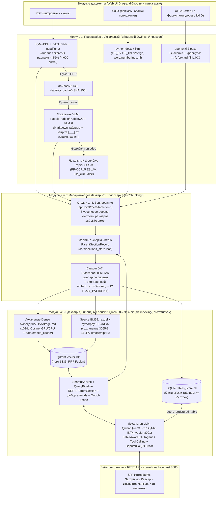
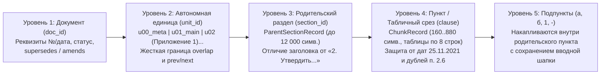
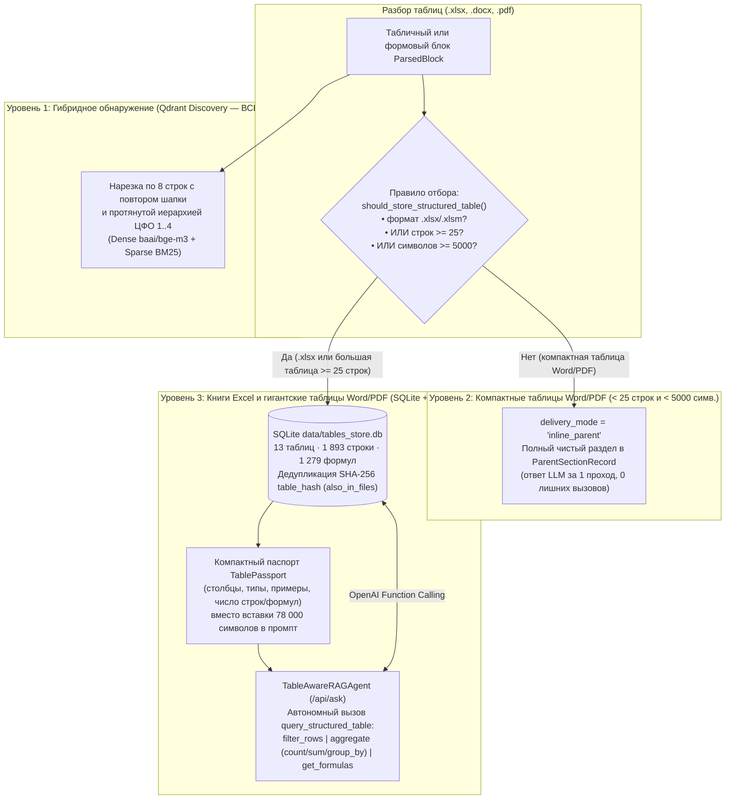

# Навигатор сотрудника по внутренним регламентам МФТИ (RAG V3: Parent-Child + 12% Overlap + 3-Tier SQLite Tables & LLM Tool Calling)

Отказоустойчивая векторно-гибридная база знаний по нормативным документам МФТИ (приказы, регламенты, распоряжения, сметы и финансовая структура в форматах `.pdf`, `.docx`, `.xlsx`) со **структурно-иерархическим чанкером схемы V3 (7 стадий, 5 уровней иерархии, Parent-Child + двустороннее перекрытие 12% по границам слов)**, **адаптивной 3-уровневой архитектурой работы с таблицами (`Qdrant 8-row Discovery` + `Inline ParentSectionRecord` для компактных таблиц + `SQLite tables_store.db` и автономный `LLM Tool Calling` для книг `.xlsx` и больших таблиц Word/PDF)**, двухуровневым гибридным OCR-контуром, графом версионности и частичных изменений приказов (`supersedes` / `amends`) и локальным веб-приложением управления базой на `http://localhost:8000`.

---

## Содержание

1. [Ключевые возможности и решаемые проблемы корпуса МФТИ](#1-ключевые-возможности-и-решаемые-проблемы-корпуса-мфти)
2. [Архитектура системы и поток данных](#2-архитектура-системы-и-поток-данных)
3. [Схема иерархического чанкинга V3 (7 стадий) и 3-уровневая архитектура таблиц](#3-схема-иерархического-чанкинга-v3-7-стадий)
   - [3.1. Адаптивная 3-уровневая архитектура таблиц (3-Tier Adaptive Table Architecture)](#31-адаптивная-3-уровневая-архитектура-таблиц-3-tier-adaptive-table-architecture)
4. [Требования к окружению, зависимости и внешние сервисы](#4-требования-к-окружению-зависимости-и-внешние-сервисы)
5. [Настройки и переменные окружения (`.env`)](#5-настройки-и-переменные-окружения-env)
6. [Быстрый запуск и остановка (Docker Compose и локально)](#6-быстрый-запуск-и-остановка-docker-compose-и-локально)
7. [Руководство по веб-приложению (`http://localhost:8000`)](#7-руководство-по-веб-приложению-httplocalhost8000)
8. [Справочник REST API](#8-справочник-rest-api)
9. [Типовые пользовательские сценарии (Use Cases)](#9-типовые-пользовательские-сценарии-use-cases)
10. [Результаты комплексной валидации (`verify_retrieval.py`, `verify_tables_e2e.py` и `pytest`)](#10-результаты-комплексной-валидации-verify_retrievalpy-verify_tables_e2epy-и-pytest)
11. [Ограничения решения и план дальнейшего развития (Roadmap)](#11-ограничения-решения-и-план-дальнейшего-развития-roadmap)

---

## 1. Ключевые возможности и решаемые проблемы корпуса МФТИ

Система спроектирована без использования примитивных символьных сплиттеров (`RecursiveCharacterTextSplitter`, `TokenTextSplitter`), которые разрушают структуру нормативных актов. Вместо них реализован специализированный доменный конвейер:

- **Двухуровневый локальный гибридный OCR с защитой от ловушек сканов:**
  - Автоматическое определение комбинированных сканов, где поверх растрового изображения наложен короткий текстовый штамп согласования/ЭДО (`Регламент поселения сотрудников.pdf` стр. 1 — 148 символов штампа; `Регламент бронирования конц зала.pdf` стр. 6 — 13 символов).
  - Рендеринг при `300 DPI` с автоповоротом альбомных страниц и ограничением длинной стороны `MAX_OCR_IMAGE_SIDE = 3509 px` для гигантских сканов (`5167×7305 px`).
  - Основной локальный контур: компактная SOTA документная Vision-Language модель **`PaddlePaddle/PaddleOCR-VL-1.6`** (`0.9B`, `OmniDocBench v1.6 = 96.33%`) на GPU/CPU через `transformers` с конвертацией таблиц в Markdown и жесткой защитой от зацикливания на пустых бланках подписей (`[___]` вместо бесконечных `_____` на стр. 7 `Регламент бронирования конц зала.pdf`).
  - Автоматический локальный CPU-фоллбэк: `RapidOCR v3 (PP-OCRv5, ESLAV, MOBILE)` с `Global.use_cls = False` (предотвращает переворот широких русских строк на 180°) и `Det.box_thresh = 0.3`.
- **Двухпроходный парсинг таблиц и формул Excel (`.xlsx`) и списков Word (`.docx`):**
  - Одновременное чтение вычисленных значений (`data_only=True`) и зашитых формул (`data_only=False`) в формате `[формула: =SUM(...)]`. Решает проблему пустых `cached_value=None` в книге `Приложение 1_новая смета 2019 (с незащищенными формулами).xlsx` (848 формул, коды КВР/КОСГУ, НДС 20%, накладные 20%) без записи `"None"`.
  - Протяжка (`forward-fill`) объединенных ячеек и 5-уровневой иерархии подразделений (`Финансодержатель -> ЦФО 1 -> ЦФО 2 -> ЦФО 3 -> ЦФО 4` в `Приложение к приказу об утверждении фин. структуры 2026г..xlsx`).
  - Полная поддержка как явной нумерации пунктов, так и XML-автонумерации Word (`w:numPr` + `word/numbering.xml`), а также склейка оторванных номеров пунктов в PDF (`Регламент поиска и подбора персонала.pdf`).
- **Граф редакций, отмен и частичных изменений (`supersedes` / `amends`):**
  - Различение полной отмены документа (`Приказ № 794-1` отменяет `1469-1`, но оставляет смету 2019 г. в статусе `superseded_template_reference` как единственный источник кодов КВР/КОСГУ и формул; `Приказ № 5990-1` отменяет `1465-1`) и частичного изменения (`Распоряжение № 700` изменяет `Приказ № 3065-1` по ФЛС без отмены базового приказа).
  - При поиске по частично измененному приказу (`3065-1`) система автоматически добирает изменяющие чанки из `Распоряжения № 700` в `amendment_chunks` и формирует `version_alerts`.
- **Кросс-файловая дедупликация (`content_hash` + `also_in_files`):**
  - Нормализованный SHA-256 хэш текста предотвращает засорение топ-выдачи идентичными приложениями из разных файлов (`Приказ N 3699-1` и `Приложения к приказу_ о формировании бюджетирования 2026г..docx`; `Приказ N 3614-1` и `.xlsx` финструктуры), объединяя источники в поле `also_in_files`.

---

## 2. Архитектура системы и поток данных



### Сквозной поток данных (от входа до выхода)

1. **Контур индексации (`Вход: файлы .pdf / .docx / .xlsx` → `Выход: индексы Qdrant + SQLite + Реестр`):**
   - Пользователь загружает документы через Drag-and-Drop в веб-интерфейсе (`POST /api/documents/upload`) или синхронизирует папку `доки/` (`POST /api/documents/sync-folder`).
   - Конвейер вычисляет `SHA-256` файла, определяет сканированные и комбинированные страницы PDF (штамп ЭДО поверх скана) и распознает их локальной моделью **`PaddlePaddle/PaddleOCR-VL-1.6`** (с фоллбэком на `RapidOCR v3 PP-OCRv5 ESLAV`), извлекает формулы и значения `.xlsx` в два прохода и автонумерацию `.docx`.
   - 7-стадийный чанкер `HierarchicalChunkerV3` строит чистые родительские разделы (`ParentSectionRecord` в `sections_store.json`), дочерние чанки с `12%` перекрытием по границам слов и выгружает книги Excel и большие таблицы (`>= 25` строк) в `SQLite tables_store.db`.
   - Локальный эмбеддер **`BAAI/bge-m3`** (`1024d`) + морфологический `BM25` (`pymorphy3` + `CRC32`) индексируют чанки в **Qdrant**, а граф редакций связывает отменяемые (`supersedes`) и изменяемые (`amends`) акты.
2. **Контур ответа сотруднику (`Вход: вопрос на естественном языке` → `Выход: структурированный ответ с цитатами и статусом документа`):**
   - Вопрос поступает в `POST /api/ask` (или `POST /api/search`). `QueryPipeline` нормализует разговорную формулировку, расширяет аббревиатуры по `GlossaryManager` и проверяет релевантность (`Out-of-Scope` детектор).
   - `SearchService` выполняет гибридный поиск в Qdrant (`Dense + Sparse BM25` со слиянием `Reciprocal Rank Fusion`), подтягивает чистые родительские разделы `ParentSectionRecord`, автоматически добирает изменяющие чанки (`amendment_chunks`) и предупреждения об отмене/изменении (`version_alerts`).
   - Агент `TableAwareRAGAgent` на базе 4-битной линейно-гибридной модели **`Qwen/Qwen3.8-27B`** (`vLLM` `W4A16`, порт `8001`) при наличии связанных таблиц `delivery_mode="tool_query"` автономно вызывает инструмент `query_structured_table` (`filter_rows`, `aggregate`, `get_formulas`) к `SQLite`, синтезирует пошаговый ответ с указанием подразделений/форм/сроков, проверяет точность цитат и возвращает структурированный `AgentAskResponse` (ответ, статус актуальности источников, проверенные цитаты и трассировка `ToolCallTrace`).

### Структура репозитория

```text
.
├── config/
│   ├── glossary.yaml               # Доменный словарь аббревиатур, синонимы и 12 ROLE_PATTERNS
│   └── registry_overrides.yaml     # Опциональные переопределения связей редакций (не запекается в Docker-образ)
├── scripts/
│   ├── docker-entrypoint.sh        # Entrypoint контейнера: инициализация пустых томов и ожидание Qdrant
│   └── start_local_stack.sh        # Скрипт локального запуска Qdrant + vLLM (Qwen3.8-27B INT4) + FastAPI
├── src/
│   ├── config.py                   # Константы, пороги, настройки .env и выбор локальных бэкендов
│   ├── schemas.py                  # Модели Pydantic v2 (ParsedBlock, ChunkRecord, TablePassport, AgentAskResponse и др.)
│   ├── llm/
│   │   └── local_qwen.py           # Поддержка Qwen/Qwen3.8-27B в 4-битной квантизации (vLLM INT4 и BitsAndBytes NF4)
│   ├── ingestion/
│   │   ├── ocr_engine.py           # Локальный гибридный OCR: PaddlePaddle/PaddleOCR-VL-1.6 + RapidOCR v3 PP-OCRv5 ESLAV
│   │   └── parsers.py              # Парсеры PDF, DOCX, XLSX в поток типизированных ParsedBlock
│   ├── chunking/
│   │   ├── glossary.py             # GlossaryManager + автообучение терминам + ролевые паттерны
│   │   └── hierarchical_chunker.py # 7-стадийный конечный автомат чанкинга схемы V3
│   ├── indexing/
│   │   ├── embedder.py             # Локальный Dense (BAAI/bge-m3, sentence-transformers) + русский Sparse BM25
│   │   ├── qdrant_store.py         # Работа с Qdrant, гибридный запрос Prefetch + RRF Fusion
│   │   ├── table_store.py          # SQLite-движок StructuredTableStore и OpenAI-инструменты таблиц
│   │   └── pipeline.py             # Оркестратор индексации, таблиц, дедупликации и графа редакций
│   ├── retrieval/
│   │   ├── query_pipeline.py       # Нормализация запроса, переписывание и оценка уверенности
│   │   ├── search_service.py       # Гибридный поиск, 3-уровневая маршрутизация таблиц, добор amends, Out-of-Scope
│   │   └── rag_agent.py            # Автономный ИИ-агент TableAwareRAGAgent + верификация цитат
│   └── web/
│       ├── app.py                  # FastAPI сервер на http://localhost:8000
│       └── static/                 # Русскоязычный SPA-интерфейс (чат-навигатор, инспектор, просмотрщик стр.)
├── tests/                          # Автотесты (200+ модульных и интеграционных тестов pytest)
├── verify_retrieval.py             # Скрипт комплексной E2E-проверки гибридного поиска (10 сценариев)
├── verify_tables_e2e.py            # Скрипт E2E-проверки SQLite-таблиц и живого LLM Tool Calling (5 сценариев)
├── Dockerfile                      # Чистый образ приложения без предзашитой базы данных и регламентов
├── .dockerignore                   # Строгое исключение data/, доки/, *.pdf/*.docx/*.xlsx из контекста сборки
├── docker-compose.yml              # Полный локальный стек: qdrant (6333) + vllm-qwen38 (8001) + rag-app (8000)
├── .env.example                    # Шаблон переменных окружения для локального и Docker-запуска
├── requirements.txt                # Зафиксированные зависимости Python 3.12
└── README.md                       # Документация проекта
```

---

## 3. Схема иерархического чанкинга V3 (7 стадий)

Чанкер `HierarchicalChunkerV3` (`src/chunking/hierarchical_chunker.py`) разбирает поток `ParsedBlock` в **5-уровневое иерархическое дерево** и формирует дочерние чанки (`ChunkRecord`) и родительские разделы (`ParentSectionRecord`):



### Последовательность 7 стадий обработки

1. **Стадия 1 (Зонирование и очистка шума):**
   - По триггеру `ЛИСТ СОГЛАСОВАНИЯ` переводит блоки в неответную зону `zone="approval"`, а при встрече `Приложение №...`, `УТВЕРЖДЕН...`, `РЕГЛАМЕНТ`, `ПОРЯДОК` автоматически возвращает `zone="normative"`.
   - Склеивает дефисные переносы строк PDF, удаляет колонтитулы (`Стр. 3 из 14`), очищает прилипшие сноски в номерах актов (`№ 8123 -> № 812`) и разворачивает однострочные таблицы-рамки реквизитов Word (`от 28.03.2023 | № 794-1`) для извлечения номера и даты.
2. **Стадия 2 (Построение 5-уровневой иерархии):**
   - Смена `unit_id` (`u01_main`, `u02`...) при переходе к приложениям/утвержденным регламентам со сбросом нумерации разделов.
   - Умное различение заголовков разделов (`SECTION_TITLE_STARTERS`: *порядок, общие положения, правила, требования*...) и распорядительных пунктов приказа (`IMPERATIVE_VERB_STOPWORDS`: *утвердить, возложить, отменить, приказываю*...).
   - Защита от ложного срабатывания на даты (`DATE_PREFIX_RE`: `25.11.2021`, `01.09.2025` никогда не бьются как п. `25.11` или `1.9`) и защита от дублирующихся номеров пунктов в исходнике (`п. 2.6` и `2.7` в Приказе № 3065-1, `п. 3.2` в Распоряжении № 700 получают уникальные синтетические `chunk_id` и детерминированные `UUIDv5`).
3. **Стадия 3 (Специальная нарезка таблиц, форм и `u00_meta`):**
   - `zone="table"`: нарезка пачками по `TABLE_SLICE_ROWS = 8` строк с принудительным повтором шапки таблицы (`table_headers`) и протянутой иерархии (`Финансодержатель -> ЦФО 1..4`).
   - `zone="form"`: компактная упаковка бланков смет и заявок по `380–560` символов с сохранением кодов КВР/КОСГУ и формул `[формула: =...]`.
   - `zone="meta"`: генерация карточки паспорта версионности `u00_meta` (не занимает слоты нормативной выдачи, но поднимает `version_alerts` и `quality_alerts`).
4. **Стадия 4 (Двусторонний контроль размера `MIN_CLAUSE_CHARS = 160` .. `MAX_CLAUSE_CHARS = 880`):**
   - Разрезание длинных пунктов по границам предложений/подпунктов с подстановкой шапки `(Продолжение п. X: <первые 120 симв.>...)` и нумерацией частей `п. X (ч. 1)`, `п. X (ч. 2)`.
   - 3-проходное слияние коротких чанков (`< 160` символов): проход вперед внутри раздела (`"1.2, 1.3"`), проход назад для хвостового остатка и приклейка одиночных коротких блоков внутри `unit_id`.
5. **Стадия 5 (Сборка чистых родительских разделов `ParentSectionRecord`):**
   - Выполняется **строго после Стадии 4 и до Стадии 6**, формируя чистый текст раздела без дублирующихся хвостов перекрытия (до `12 000` символов) и сохраняя его в `data/sections_store.json`.
6. **Стадия 6 (Билатеральное перекрытие 12% строго по границам слов):**
   - Для каждого чанка `i` внутри одного `unit_id` вычисляется `12%` overlap: для текста в окне **`35–95` символов**, для таблиц/форм в окне **`24–48` символов**.
   - Сверху добавляется `...<хвост чанка i-1>`, снизу — `<начало чанка i+1>...` строго по границам пробелов/слов без разрезания слов или чисел. Между разными `unit_id` (`u01_main` и `u02`) перекрытия и ссылки `prev_id`/`next_id` жестко изолированы.
7. **Стадия 7 (Формирование `raw_text` и обогащенного `embed_text`):**
   - Формирует контекстный `embed_text` с реквизитами документа, статусом, годами действия, названием раздела, ролями и расшифровками аббревиатур из `GlossaryManager`:
     ```text
     [Документ: <Название> (№ <номер> от <дата>) | Редакция/Статус: <status_ru> | Годы: <applicable_years> | Часть: <unit_title> | Раздел <N>: <section_title> | Пункт: <clause_no> | Роли: <roles> | Темы: <topics>]
     [Термины: <АББР (расшифровка)>; ...]
     <raw_text>
     ```

### 3.1. Адаптивная 3-уровневая архитектура таблиц (3-Tier Adaptive Table Architecture)

В нормативной базе МФТИ встречаются принципиально разные классы таблиц: от компактных 7-строчных таблиц лимитов репетиций внутри скана PDF (`Регламент бронирования конц зала.pdf`, стр. 4 п. 6.1) до широких книг Excel со сложными расчетными формулами (`Приложение 1_новая смета 2019.xlsx`, 1 279 формул) и гигантских 524-строчных таблиц дерева ЦФО на 78 000 символов как в `.xlsx`, так и внутри `.docx` (`Приказ N 3614-1 от 11.08.2025 по Фин.структуре 2026г..docx`).

Чтобы одновременно обеспечить высокую точность семантического поиска, отсутствие раздувания промпта и 100%-ю математическую точность фильтрации и подсчета (`COUNT`, `SUM`, `GROUP BY`, извлечение формул `[формула: =...]`), реализована **3-уровневая адаптивная маршрутизация таблиц**:



1. **Уровень 1 (`Qdrant 8-Row Discovery` — работает для всех таблиц):**
   - Каждая таблица (`.xlsx`, `.docx`, `.pdf`) нарезается пачками по `8` строк с повтором шапки и родительской иерархии. Это гарантирует, что гибридный поиск (`baai/bge-m3` + `BM25 RRF`) мгновенно находит нужную таблицу даже по глубокой строке или ФИО финансодержателя на 400-й строке.
2. **Уровень 2 (`inline_parent` — компактные таблицы Word и PDF `< 25` строк и `< 5 000` символов):**
   - Компактные нормативные таблицы (например, таблица лимитов репетиционных дней в Концертном зале из `Регламент бронирования конц зала.pdf`, п. 6.1) **не создают лишних таблиц в SQLite** и доставляются целиком внутри чистого `ParentSectionRecord`. Агент отвечает по ним за **1 проход (`used_table_tools = False`)** без сетевых задержек на второй раунд.
3. **Уровень 3 (`tool_query` — все книги `.xlsx` и крупные таблицы Word/PDF `>= 25` строк или `>= 5 000` символов):**
   - Все листы Excel (`Фин. структура 2026г..xlsx`, `новая смета 2019.xlsx`) и большие таблицы Word (`Приказ N 3614-1.docx` — 524 строки / 77 986 симв.; `Приказ N 3699-1.docx` и `Приложения бюджетирования 2026г..docx`; `Распоряжение N 700.docx` — 97 строк) автоматически сохраняются в реляционное хранилище **`data/tables_store.db`** (`StructuredTableStore`) с типизацией колонок, числовыми значениями и извлеченными формулами `[формула: =...]`.
   - Идентичные таблицы в разных форматах (например, Таблица № 4 в `Приказ N 3614-1.docx` и лист `2026` в `Фин. структура 2026г..xlsx`) связываются по нормализованному `SHA-256 table_hash` в поле `also_in_files`.
   - При запросе к `/api/ask` агент `TableAwareRAGAgent` получает компактный `TablePassport` и **автономно вызывает инструмент `query_structured_table`** (`filter_rows`, `aggregate` [`count`, `distinct`, `sum`, `avg`, `min`, `max`, `group_by`], `get_formulas`), возвращая точные цифры и полную трассировку вызовов `ToolCallTrace`.

---

## 4. Требования к окружению, зависимости и внешние сервисы

### Требования к окружению и аппаратным ресурсам
- **ОС:** Linux (`Ubuntu 22.04+`, `Debian 12+`) или Windows (WSL2)
- **Python:** `3.12+` (`CPython 3.12`)
- **Docker и Docker Compose:** `Docker Engine 24.0+`, `docker compose v2` и `NVIDIA Container Toolkit` (`nvidia-ctk`) для проброса GPU в контейнеры `vllm-qwen38` и `rag-app`
- **GPU (VRAM):** рекомендуется **NVIDIA GPU от `24 ГБ` до `40+ ГБ` VRAM** (`A100 40GB`, `L40S`, `RTX 3090 / 4090`) для одновременного размещения 4-битной `Qwen/Qwen3.8-27B` (~`16.5 ГБ` весов + KV-кэш `vLLM`), `BAAI/bge-m3` (~`2.2 ГБ`) и `PaddlePaddle/PaddleOCR-VL-1.6` (~`1.9 ГБ`)
- **ОЗУ и диск:** от `16 ГБ` системной ОЗУ и от `35 ГБ` свободного места на диске под кэш весов HuggingFace (`hf_cache`) и Docker-образы

### Перечень сервисов и политика конфиденциальности (100% On-Premise)
- **Внешние облачные API:** **не требуются (`0` внешних API-вызовов при работе с документами и запросами)**. Все конфиденциальные внутренние регламенты, приказы, таблицы ЦФО и вопросы сотрудников обрабатываются строго в локальном контуре в полном соответствии с требованиями ТЗ. Единственное обращение к внешней сети при первом холодном старте — скачивание открытых весов моделей с `HuggingFace Hub` в персистентный том `hf_cache` (поддерживается полностью офлайн-запуск с предзагруженным кэшем `HF_HUB_OFFLINE=1`).
- **Инфраструктурные сервисы `docker-compose.yml`:**
  1. **`vllm-qwen38` (`vllm/vllm-openai:latest`, порт `8001`)** — локальный OpenAI-совместимый сервер линейно-гибридной LLM **`Qwen/Qwen3.8-27B`** в 4-битной квантизации (`RedHatAI/Qwen3.8-27B-INT4`, `Marlin W4A16` + `Triton GDN` + `CUDA Graphs`, контекст `65 536` токенов, `--tool-call-parser qwen3_xml`, `--reasoning-parser qwen3`). Поддерживается также альтернативный внутрипроцессный режим `LLM_BACKEND=local_bnb_4bit` (`BitsAndBytes NF4`).
  2. **`qdrant` (`qdrant/qdrant:latest`, порт `6333`)** — локальная векторная СУБД для гибридного поиска по Dense (`1024d`) и Sparse (`BM25 + IDF`) векторам со слиянием `Reciprocal Rank Fusion (RRF)`.
  3. **`rag-app` (`Dockerfile`, порт `8000`)** — веб-приложение FastAPI + SPA-интерфейс + локальные модели **`BAAI/bge-m3`** (`sentence-transformers`, `1024d`) и **`PaddlePaddle/PaddleOCR-VL-1.6`** (`transformers` + фоллбэк `RapidOCR v3 PP-OCRv5 ESLAV`) + встроенное реляционное хранилище `SQLite` (`tables_store.db`).

### Основные зависимости (`requirements.txt` и системные пакеты `Dockerfile`)
- **Системные пакеты (внутри `Dockerfile`):** `libreoffice-writer-nogui`, `libreoffice-calc-nogui` (рендеринг визуальных превью `.docx`/`.xlsx`), `fonts-dejavu-core`, `fonts-liberation`, `libgl1`, `libglib2.0-0`, `libgomp1`, `curl`
- **Локальные ML/NLP и VLM библиотеки:** `torch`, `transformers>=4.51`, `accelerate`, `bitsandbytes`, `sentence-transformers`, `huggingface-hub`, `safetensors`, `einops`, `razdel`, `pymorphy3`
- **Парсинг и гибридный OCR:** `PyMuPDF`, `pypdfium2`, `pdfplumber`, `Pillow`, `rapidocr`, `onnxruntime`, `python-docx`, `lxml`, `openpyxl`
- **Веб-сервер, векторный поиск и тестирование:** `fastapi`, `uvicorn[standard]`, `python-multipart`, `httpx`, `pydantic>=2.0`, `pydantic-settings`, `qdrant-client`, `openai`, `tenacity`, `pytest`, `pytest-asyncio`

---

## 5. Настройки и переменные окружения (`.env`)

Конфигурация считывается из переменных окружения и опционального файла `.env` (шаблон — `.env.example`). При запуске через `docker compose` проект стартует **сразу из чистого `git clone` даже без создания `.env`** (`required: false`):

| Переменная | Значение по умолчанию | Описание |
| :--- | :--- | :--- |
| `LLM_BACKEND` | `local_vllm` | Локальный режим LLM: `local_vllm` (сервер vLLM INT4) или `local_bnb_4bit` (внутрипроцессный `BitsAndBytes NF4`) |
| `LOCAL_LLM_BASE_URL` | `http://localhost:8001/v1` | Адрес локального сервера `vLLM` при хостовом запуске |
| `DOCKER_LLM_BASE_URL` | `http://vllm-qwen38:8001/v1` | Адрес контейнера `vllm-qwen38` внутри сети Docker Compose |
| `LOCAL_LLM_MODEL` | `Qwen/Qwen3.8-27B` | Линейно-гибридная модель `Qwen/Qwen3.8-27B` (в 4-битной квантизации) |
| `LOCAL_LLM_HF_QUANTIZED_REPO` | `RedHatAI/Qwen3.8-27B-INT4` | Репозиторий 4-битных весов `W4A16` для `vLLM` |
| `LLM_QUANTIZATION` | `4bit` | Режим квантизации LLM |
| `VLLM_GPU_MEMORY_UTILIZATION` | `0.68` | Доля VRAM GPU под сервер `vLLM` (оставляет запас под `bge-m3` и `PaddleOCR-VL-1.6`) |
| `VLLM_MAX_MODEL_LEN` | `65536` | Максимальная длина контекста `vLLM` для многошагового Tool Calling |
| `EMBEDDING_BACKEND` | `local` | Локальный контур эмбеддингов (`sentence-transformers`) |
| `EMBEDDING_MODEL` | `BAAI/bge-m3` | Локальная модель плотных векторов (`1024d`, Cosine) |
| `EMBEDDING_DEVICE` | `auto` | Устройство эмбеддингов (`auto` / `cuda` / `cpu`) |
| `OCR_BACKEND` | `paddleocr_vl` | Локальный контур OCR: `paddleocr_vl` (`PaddlePaddle/PaddleOCR-VL-1.6` + фоллбэк `RapidOCR`) или `local_rapidocr` |
| `OCR_VL_MODEL` | `PaddlePaddle/PaddleOCR-VL-1.6` | Локальная Vision-Language OCR модель для сканов и таблиц |
| `QDRANT_URL` | `http://localhost:6333` | URL Qdrant при хостовом запуске |
| `DOCKER_QDRANT_URL` | `http://qdrant:6333` | URL контейнера Qdrant внутри сети Docker Compose |
| `QDRANT_COLLECTION` | `mipt_normative_v3` | Название коллекции в Qdrant |
| `AUTO_SYNC_ON_STARTUP` | `false` | Автоматическая синхронизация примонтированной папки `DOCS_DIR` при старте контейнера |
| `DOCS_DIR` / `DATA_DIR` / `CONFIG_DIR` | `доки` / `data` / `config` | Рабочие директории документов, индексов и словаря |
| `APP_HOST` / `APP_PORT` | `0.0.0.0` / `8000` | Хост и порт веб-сервера FastAPI (`http://localhost:8000`) |

---

## 6. Быстрый запуск и остановка (Docker Compose и локально)

> **Чистый образ без предзашитых баз и регламентов:** в соответствии с требованиями воспроизводимости `.dockerignore` и `Dockerfile` **строго исключают** локальные директории `data/`, `доки/`, `qdrant_storage/` и любые файлы `.pdf`/`.docx`/`.xlsx`. Контейнер поднимается с чистыми именованными Docker-томами (`qdrant_storage`, `rag_data`, `hf_cache`) без ручных правок исходного кода, после чего любые регламенты загружаются через веб-интерфейс (`http://localhost:8000`) или `POST /api/documents/upload`.

### Вариант А. Полный контейнерный запуск через Docker Compose (рекомендуется)

```bash
# 1. (Опционально) Создайте .env из шаблона, если хотите переопределить порты или HF_TOKEN:
cp .env.example .env

# 2. Соберите и запустите весь локальный стек: Qdrant (:6333) + vLLM Qwen3.8-27B INT4 (:8001) + rag-app (:8000):
docker compose up -d --build

# 3. Просмотр логов готовности сервисов и проверка healthcheck:
docker compose ps
curl http://localhost:8000/api/health

# 4. Откройте веб-приложение в браузере http://localhost:8000 и загрузите документы через Drag-and-Drop
#    (либо через API: curl -F "files=@/path/to/reglament.pdf" http://localhost:8000/api/documents/upload)

# 5. Штатная остановка всех контейнеров (с сохранением данных в именованных томах):
docker compose down

# 6. Полная остановка со сбросом томов базы данных (для повторной проверки «с чистого листа»):
docker compose down -v
```

### Вариант Б. Локальный запуск на GPU-сервере / в виртуальном окружении Python 3.12

```bash
# 1. Установка зависимостей:
pip install -r requirements.txt

# 2. Запуск всего локального стека (Qdrant + vLLM Qwen3.8-27B INT4 + FastAPI) одним скриптом:
./scripts/start_local_stack.sh

# 3. Запуск модульных/интеграционных автотестов (200+ тестов) и E2E-валидации:
pytest -v
python3 verify_retrieval.py
python3 verify_tables_e2e.py --api-url http://127.0.0.1:8000
```

---

## 7. Руководство по веб-приложению (`http://localhost:8000`)

Откройте в браузере **`http://localhost:8000`**. Интерфейс разделен на 3 рабочие вкладки и интерактивный конструктор таблиц:

1. **«Загрузка и синхронизация»:**
   - **Кнопка «Синхронизировать папку `доки/`»** — сканирует папку `доки/`, вычисляет `SHA-256` каждого файла и инкрементально индексирует новые или изменившиеся документы без изменения исходного кода.
   - **Drag-and-Drop мультизагрузка файлов (`.pdf`, `.docx`, `.xlsx`)** — позволяет загрузить новые приказы или регламенты прямо из браузера с указанием метаданных: статуса (`active`, `superseded`, `superseded_template_reference`, `draft`), номеров отменяемых (`supersedes`) и изменяемых (`amends`) приказов, годов действия (`applicable_years`), комментария к редакции (`version_note`) и режима OCR (`hybrid_vlm` / `local_rapidocr`).
   - **Живой прогресс-бар по 6 стадиям** (*Предразбор → OCR сканов → Иерархический чанкинг V3 → Наложение 12% overlap → Векторизация `baai/bge-m3` + BM25 → Запись в Qdrant и SQLite*) со счетчиком созданных разделов, чанков и структурированных таблиц.
2. **«Реестр документов и инспектор чанков»:**
   - Таблица всех документов с реквизитами (номер, дата, формат, страницы/OCR-страницы, число `Parent`-разделов, `Child`-чанков и `Таблиц SQLite`), статусными плашками и бейджами графа редакций (`Изменяет № 3065-1`, `Отменен № 794-1`, `Дублируется в ...`).
   - **Модальное окно инспектора чанков:** визуальный просмотр дерева `unit_id -> ParentSectionRecord -> ChunkRecord`, переключение между `raw_text` (с визуальной подсветкой верхнего и нижнего `...12% overlap...`) и полным `embed_text`, редактирование связей документа (`PATCH`) и удаление из базы (`DELETE`).
3. **«Тест гибридного поиска и ИИ-агента (RAG Playground)»:**
   - Переключатель режима **«🤖 ИИ-ответ с авто-дозапросом таблиц (Tool Calling)»** (`POST /api/ask`) и **«🔎 Гибридный RRF-поиск»** (`POST /api/search`), а также быстрые пресеты по корпусу МФТИ.
   - Карточка **ИИ-ответа** с отформатированным текстом, бейджем модели и раскрывающимся блоком **«Трассировка вызовов инструмента таблиц (`ToolCallTrace`)»**, показывающим каждый шаг вызова `query_structured_table` (операция, JSON-фильтры, число совпавших строк в SQLite и превью таблицы).
   - Карточки паспортов таблиц **`linked_tables` (`TablePassport`)** и архитектурные бейджи на результатах поиска (`📊 XL / Большая таблица · SQLite + Tool Query` vs `📄 Компактная таблица Word/PDF · Встроена целиком в Parent`).
   - **Интерактивный конструктор запросов к таблицам (`#table-explorer-modal`):** открывается с любой карточки `TablePassport` или из шапки/реестра и позволяет выполнять живую фильтрацию строк (`filter_rows`), агрегацию (`count` / `sum` / `distinct` / `avg` / `min` / `max` + `group_by`) и просмотр формул Excel (`get_formulas`) через `POST /api/tables/query`.

---

## 8. Справочник REST API

Автоматическая интерактивная документация Swagger UI доступна по адресу **`http://localhost:8000/docs`**.

| Метод и путь | Описание |
| :--- | :--- |
| `GET /api/health` | Статус подключения к Qdrant, локальному контуру моделей (`Qwen/Qwen3.8-27B` 4-bit, `BAAI/bge-m3`, `PaddleOCR-VL-1.6`), число точек в коллекции, документов в реестре и таблиц в `tables_store.db` |
| `POST /api/documents/sync-folder` | Инкрементальная синхронизация папки `доки/` по `SHA-256` (параметры `force`, `ocr_backend`) |
| `POST /api/documents/upload` | Мультизагрузка новых файлов (`multipart/form-data`) с метаданными версионности и запуском индексации |
| `GET /api/documents` | Список всех документов реестра, граф связей редакций, `tables_count` и отчет `indexing_report.json` |
| `GET /api/documents/{doc_id}/chunks` | Полное дерево родительских разделов (`sections`) и дочерних чанков (`chunks`) документа |
| `PATCH /api/documents/{doc_id}/metadata` | Обновление связей (`supersedes`, `amends`, `status`, `version_note`, `applicable_years`) в реестре и Qdrant |
| `DELETE /api/documents/{doc_id}` | Полное удаление документа из Qdrant, `tables_store.db`, `sections_store.json` и `document_registry.json` |
| `GET /api/tables` | Список всех паспортов таблиц `TablePassport` в SQLite `tables_store.db` (с опциональным фильтром `?doc_id=`) |
| `GET /api/tables/{table_id}` | Детальная схема `TablePassport`, превью первых строк и сводка по формулам Excel для выбранной таблицы |
| `POST /api/tables/query` | Детерминированный SQLite-запрос `TableQueryRequest` (`filter_rows`, `aggregate`, `get_formulas`, `get_rows`) -> `TableQueryResponse` |
| `POST /api/tables/rebuild` | Быстрая пересборка `data/tables_store.db` и патч `table_id` в Qdrant по теплому кэшу (`0` платных вызовов API) |
| `POST /api/search` | Гибридный поиск (Dense `baai/bge-m3` + Sparse `BM25` + `RRF`) с возвратом `hits`, `linked_tables`, `amendment_chunks`, `version_alerts` и `is_out_of_scope` |
| `POST /api/ask` | Автономный ИИ-агент `TableAwareRAGAgent`: гибридный поиск + 3-уровневая маршрутизация таблиц + многошаговый OpenAI `Tool Calling` по SQLite-таблицам (`AgentAskResponse`) |

---

## 9. Типовые пользовательские сценарии (Use Cases)

### Use Case 1: Разговорный вопрос по сканированному регламенту (бронирование Концертного зала)

- **Входной запрос (`POST /api/search`):**
  ```json
  {
    "query": "Хотим провести студенческий концерт в концертном зале института: за сколько месяцев надо закинуть служебку и на какую электронную почту ее отправлять?",
    "top_k": 5,
    "include_parent": true
  }
  ```
- **Поток обработки:**
  1. `GlossaryManager` расширяет разговорный запрос доменными синонимами (`КЗ`, `служебная записка`, `культурно-массовый отдел`, `kmo@mipt.ru`).
  2. Гибридный поиск RRF находит релевантные чанки п. `2.3` и п. `2.6` из распознанного скана `Регламент бронирования конц зала.pdf` и подтягивает полный чистый текст Раздела 2 из `sections_store.json`.
- **Ожидаемый результат:**
  - `is_out_of_scope`: `false`
  - Источник: `Регламент бронирования конц зала.pdf` (Раздел 2 «Порядок бронирования Концертного зала», п. `2.3` и `2.6`).
  - Извлеченные факты: служебная записка подается **не позднее чем за 2 месяца** до даты проведения мероприятия и направляется на электронную почту культурно-массового отдела **`kmo@mipt.ru`**.

### Use Case 2: Поиск по частично измененному приказу (открытие и присвоение номера ФЛС)

- **Входной запрос (`POST /api/search`):**
  ```json
  {
    "query": "Порядок открытия финансово-лицевого счета (ФЛС) по приказу 3065-1 и актуальная структура присвоения уникального номера ФЛС (разряды кода, КФО)",
    "top_k": 5,
    "include_parent": true,
    "include_amendments": true
  }
  ```
- **Поток обработки:**
  1. Поисковый сервис находит базовый `Приказ N 3065-1 от 25.11.2021.docx` (Регламент открытия ФЛС, Раздел 2) и видит в графе редакций активную связь `amended_by: ["700"]`.
  2. Система автоматически добирает изменяющие чанки из `Распоряжение N 700 от 28.12.2024 Порядок присвоения номера ФЛС.docx` (п. `2.1–2.3` о 11–18-разрядной структуре номера ФЛС и кодах КФО `01..07, 32`) и прикрепляет предупреждение в `version_alerts`.
- **Ожидаемый результат:**
  - `is_out_of_scope`: `false`
  - В `hits` и `amendment_chunks` одновременно возвращаются нормы базового Приказа № `3065-1` (согласование Карточки проекта в 1С:ДО за 1 рабочий день) и актуальные правила присвоения номера ФЛС по Распоряжению № `700` (разряды 1–5 — код подразделения, 6–7 — код финансодержателя, 8–9 — КФО, 10–18 — шифр проекта).
  - В `version_alerts` выводится явное уведомление о частичном изменении Приказа № `3065-1` Распоряжением № `700`.

### Use Case 3: Запрос со сменой редакции и извлечением формул Excel (сметы доходов и расходов)

- **Входной запрос (`POST /api/search`):**
  ```json
  {
    "query": "Как сейчас подается и согласовывается смета доходов и расходов в 1С:ДО (Приложение 1а по приказу 794-1) и какие коды КВР/КОСГУ и формулы расчета накладных расходов 20% и НДС 20% используются в шаблоне сметы?",
    "top_k": 6
  }
  ```
- **Ожидаемый результат:**
  - Возвращаются действующий `Приказ N 794-1 от 28.03.2023.docx` + `Приложение 1а Бланк сметы.docx` (смета формируется **помесячно** в системе **1С:ДО**, кроме годовых бумажных смет РЦНИ по форме 1б) И справочный шаблон `Приложение 1_новая смета 2019 (с незащищенными формулами).xlsx` (`status="superseded_template_reference"`) с извлеченными кодами КВР/КОСГУ и формулами `[формула: =IFERROR((F$13+F$22)*$B$23*-1,)]` (накладные 20%, НДС 20%), сопровождаемые плашкой `version_alerts`.

---

## 10. Результаты комплексной валидации (`verify_retrieval.py`, `verify_tables_e2e.py` и `pytest`)

### 10.1. Статистика индексации корпуса и хранилища таблиц SQLite

- **Проиндексировано файлов:** `20` документов корпуса (`failed_files = 0`)
- **Создано родительских разделов (`ParentSectionRecord` в `data/sections_store.json`):** `142`
- **Создано дочерних чанков (`ChunkRecord` в коллекции Qdrant `mipt_normative_v3`):** `1 328`
- **Структурированных таблиц в SQLite (`data/tables_store.db`):** `14` таблиц (`1 990` строк и `1 279` ячеек с формулами Excel `[формула: =...]`)
- **Компактные таблицы в сканах PDF и Word (`< 25` строк и `< 5 000` символов):** `0` лишних таблиц в SQLite — доставляются в режиме `inline_parent` через `ParentSectionRecord` за 1 проход
- **Сканированные PDF, прошедшие локальный OCR `PaddlePaddle/PaddleOCR-VL-1.6`:** `Регламент бронирования конц зала.pdf` (включая распознавание растровой таблицы п. 6.1 с тонкой сеткой 1 px), `Регламент поселения сотрудников.pdf`, `Регламент эксплуатации центра обработки данных МФТИ, Физтех.pdf`
- **Кросс-файловая дедупликация (`content_hash` + `table_hash` + `also_in_files`):** полное совпадение `table_hash = 6c794288224d...` между 524-строчной таблицей `Приказ N 3614-1.docx` и `Приложение к приказу об утверждении фин. структуры 2026г..xlsx`, а также между 4 таблицами `Приказ N 3699-1.docx` и `Приложения к приказу_ о формировании бюджетирования 2026г..docx`
- **Модульные и интеграционные тесты (`pytest`):** `204 PASSED, 1 skipped, 0 failed` (включая тесты чанкера V3, гибридных таблиц SQLite, локальных моделей `Qwen3.8-27B`/`bge-m3`/`PaddleOCR-VL-1.6`, верификации цитат и чистой Docker-упаковки)
- **Зазор между релевантными (Scenarios 1–8) и нерелевантными (Scenarios 9–10) запросами:** `Δdense = +0.1578` (`min_in_scope = 0.6163` vs `max_out_of_scope = 0.4585`), `Δconfidence = +0.4785` (`min_in_scope = 0.6390` vs `max_out_of_scope = 0.1605`)

### 10.2. Сводная таблица E2E-валидации адаптивных таблиц и LLM Tool Calling (`verify_tables_e2e.py` — 5/5 PASS)

| № | Код сценария | Проверяемый уровень архитектуры и действие | Статус | Режим доставки | Таблицы в `linked_tables` | Вызовы `Tool Calling` | Модель | Ключевой результат проверки |
| :-: | :--- | :--- | :-: | :-: | :--- | :-: | :-: | :--- |
| 1 | `T01_XL_CFO_AGGREGATION_AND_FILTER` | Фильтрация и `COUNT` по книге Excel `Фин. структура 2026г..xlsx` (`524` строки) | ✅ PASS | `tool_query` | `app_fin_struct_2026_xlsx::tbl_01` | `True` | `Qwen/Qwen3.8-27B` (4-bit) | Точный подсчет через SQLite и ответ ИИ: ФРКТ (`10329`) = **`20` строк**, финансодержатель Крылова Е.В. = **`25` строк** |
| 2 | `T02_XL_SMETA_FORMULAS_QUERY` | Извлечение формул `[формула: =...]`, ставок и КВР/КОСГУ из `новая смета 2019.xlsx` (`1 279` формул) | ✅ PASS | `tool_query` | `app_1_smeta_2019_xlsx::tbl_01`, `tbl_02` | `True` | `Qwen/Qwen3.8-27B` (4-bit) | Извлечены формулы накладных `20%` (`=IFERROR((F$13+F$22)*$B$23*-1,)`), НДС (`$B$22`, КВР `180`/КОСГУ `189`), резерва отпусков `8.2%` (`=F31*$B$32`, КВР `111`/КОСГУ `211.03`) + алерт Приказа № `794-1` |
| 3 | `T03_DOCX_GIANT_TABLE_PROMOTION` | Авто-промоушен гигантской таблицы Word `Приказ N 3614-1.docx` (`524` строки, `77 986` симв.) в SQLite | ✅ PASS | `tool_query` | `order_3614_1_2025::tbl_01` | `True` | `Qwen/Qwen3.8-27B` (4-bit) | Совпадение `table_hash` и `also_in_files` с `.xlsx`; точный подсчет по подразделению `10665 Институт квантовых технологий` = **`22` строки** (Лебедев А.П., Серов П.А.) |
| 4 | `T04_PDF_COMPACT_TABLE_INLINE` | Компактная таблица из скана PDF `Регламент бронирования конц зала.pdf` (п. 6.1, `< 25` строк) | ✅ PASS | `inline_parent` | `[]` *(0 таблиц в SQLite)* | `False` (`0` вызовов) | `Qwen/Qwen3.8-27B` (4-bit) | Распознана `PaddleOCR-VL-1.6` и доставлена целиком в `ParentSectionRecord`; точный ответ за 1 проход: **`6` репетиционных дней** на Посвящение в студенты |
| 5 | `T05_BACKWARD_COMPAT_10_SCENARIOS` | Полный регрессионный прогон `verify_retrieval.py` (10 базовых сценариев RAG V3) | ✅ PASS | `hybrid_3tier` | — | `False` | `BAAI/bge-m3 + BM25` | Все **`10 / 10` сценариев PASSED** (`Δdense = +0.1578`, `Δconf = +0.4785`) |

### 10.3. Сводная таблица 10 контрольных сценариев гибридного поиска (`verify_retrieval.py` — 10/10 PASS)

| № | Код сценария | Проверяемая особенность базы МФТИ | Статус | `is_out_of_scope` | Top Dense Score | Confidence Score | Top RRF Score | Ключевые найденные источники и реквизиты |
| :-: | :--- | :--- | :-: | :-: | :-: | :-: | :-: | :--- |
| 1 | `S01_COLLOQUIAL_KZ` | Разговорный вопрос без казенных слов (бронирование КЗ: за сколько месяцев и на какую почту) | ✅ PASS | `False` | `0.6163` | `0.6390` | `0.6000` | `Регламент бронирования конц зала.pdf` (п. 2.3, 2.6: `2 месяца`, `kmo@mipt.ru`) |
| 2 | `S02_SCANNED_TABLE_KZ` | Табличный запрос из скана (репетиционные дни в КЗ на Посвящение в студенты) | ✅ PASS | `False` | `0.6608` | `0.7384` | `0.7500` | `Регламент бронирования конц зала.pdf` (стр. 4, табл. п. 6.1, стр. 13: `6` дней) |
| 3 | `S03_GIANT_SCAN_DORM` | Гигантский скан со штампом согласования (порядок поселения сотрудников в общежитие) | ✅ PASS | `False` | `0.7696` | `0.8133` | `0.6667` | `Регламент поселения сотрудников.pdf` (п. 1.2, 1.3, 3.1, 3.9: условия и комиссия) |
| 4 | `S04_SMETA_SUPERSESSION` | Смена редакции смет (`794-1` и Прил. 1а в 1С:ДО vs формулы КВР/КОСГУ в смете 2019 г.) | ✅ PASS | `False` | `0.8105` | `0.8583` | `1.0000` | `Приложение 1а Бланк сметы.docx`, `Приложение 1_новая смета 2019.xlsx` + `3 version_alerts` |
| 5 | `S05_FLS_AMENDMENT_GRAPH` | Частичное изменение приказа (`Приказ № 3065-1` + `Распоряжение № 700` по номеру ФЛС) | ✅ PASS | `False` | `0.7982` | `0.8890` | `0.5455` | `Приказ N 3065-1` + `Распоряжение N 700` (`5 amendment_chunks` + `2 version_alerts`) |
| 6 | `S06_BUDGET_YEARS_2026_2028` | Расхождение нормативов по годам (`Приказ № 3699-1` на 2026–2028 гг.: резерв отпусков) | ✅ PASS | `False` | `0.7725` | `0.7549` | `1.0000` | `Приказ N 3699-1 от 18.08.2025.docx` (п. 18, 19, 20: `16,4%` ППС и `8,2%` прочие) |
| 7 | `S07_EXCEL_CFO_HIERARCHY` | Дерево ЦФО из широкой таблицы Excel (`Приказ № 3614-1`: `Финансодержатель -> ЦФО 1..4`) | ✅ PASS | `False` | `0.7784` | `0.8353` | `0.5270` | `Приказ N 3614-1.docx` + `Приложение к приказу об утверждении фин. структуры 2026г..xlsx` (`also_in_files`) |
| 8 | `S08_IT_SUPPORT_AND_DC` | Цифровой и сканированный ИТ-регламенты (Первая линия ТП `helpdesk@mipt.ru`, 16 ч и ЦОД) | ✅ PASS | `False` | `0.8122` | `0.8539` | `0.6250` | `Приказ и Регламент работы первой линии техподдержки.pdf` (п. 1.1, 2.1, 3.3–3.5) + `Регламент ЦОД` |
| 9 | `S09_OUT_OF_SCOPE_MORTGAGE` | Нерелевантный запрос #1 (Оформление семейной ипотеки в Сбербанке) | ✅ PASS | `True` | `0.4585` | `0.1605` | `0.5000` | Отсечен детектором (`is_out_of_scope = True`, `lexical_overlap = 0.000`) |
| 10 | `S10_OUT_OF_SCOPE_CARBONARA` | Нерелевантный запрос #2 (Рецепт пасты карбонара с гуанчиале) | ✅ PASS | `True` | `0.3129` | `0.1095` | `0.5000` | Отсечен детектором (`is_out_of_scope = True`, `lexical_overlap = 0.000`) |

---

## 11. Ограничения решения и план дальнейшего развития (Roadmap)

### Текущие ограничения
1. **Требования к GPU для полного локального стека:** для одновременной работы 4-битной `Qwen/Qwen3.8-27B` (`vLLM`), `PaddlePaddle/PaddleOCR-VL-1.6` и `BAAI/bge-m3` с высокой скоростью отклика рекомендуется GPU с объемом видеопамяти от `24 ГБ` VRAM (на CPU фоллбэк `RapidOCR v3` и `bge-m3` работоспособны, но инференс 27B LLM существенно медленнее).
2. **Сложные рукописные пометки на сканах:** локальный гибридный контур `PaddleOCR-VL-1.6 + RapidOCR v3` оптимизирован под машинописные сканы, таблицы с тонкой сеткой и штампы ЭДО; неразборчивые рукописные резолюции поверх текста могут распознаваться с погрешностью.
3. **Автоматическое связывание графа версий без явного номера акта:** если новый приказ отменяет старый документ только по косвенному описанию без указания регистрационного номера, связь подтверждается оператором через веб-интерфейс на `http://localhost:8000`.

### План дальнейшего развития и внедрения в МФТИ
1. **Этап 1 (Интеграция с `1С:Документооборот` и корпоративным порталом МФТИ):**
   - Подключение вебхука автоматической синхронизации новых приказов и распоряжений напрямую из `1С:ДО` в `/api/documents/upload` сразу после регистрации штампа ЭДО.
2. **Этап 2 (SSO-авторизация и ролевая персонализация маршрутов):**
   - Учет роли сотрудника (ППС, руководитель научного проекта РНФ, администратор подразделения) через корпоративный Keycloak/LDAP для автоматического выбора ветки согласования (например, п. `2.3.1–2.3.5` Приказа № 794-1).
3. **Этап 3 (Корпоративный Telegram/Mattermost-бот сотрудника):**
   - Подключение легковесного чат-бота поверх единого локального API `/api/ask` с прямой отправкой проверенных выдержек и ссылок на страницы регламентов.
